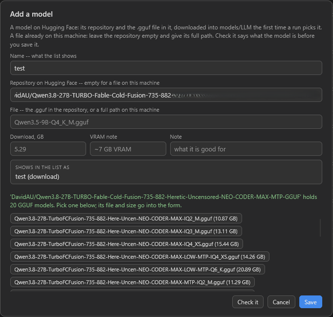

# YuE2 for ComfyUI

面向 [YuE2-3B](https://huggingface.co/m-a-p/YuE2-3B) 的 ComfyUI 节点。输入一段风格描述
和歌词，输出一份看得懂的乐谱和一首完整的 48 kHz 立体声歌曲，全部在你自己的机器上生成。

[English version](README.md) | [Русская версия](README_RU.md) | [更新日志](CHANGELOG.md)

> **本文档为机器翻译。** 本项目作者不懂中文，这份中文 README 是由 AI 从英文版翻译过来的。
> 术语和措辞难免有不准确的地方；如果发现错误、意思偏了或者读不通顺的段落，欢迎到
> [issue](https://github.com/pytraveler/YuE2-ComfyUI/issues)
> 里指出来，我会改。两边说法有出入时，以[英文版](README.md)为准。

<p align="center">
  <a href="https://github.com/pytraveler/YuE2-ComfyUI/releases/latest"></a>
  <a href="LICENSE"></a>
  
  <a href="https://huggingface.co/m-a-p/YuE2-3B"></a>
  <a href="https://huggingface.co/m-a-p/YuE2-Vae"></a>
  <a href="NOTICE.md"></a>
</p>

![ComfyUI 中的 YuE2 Generate Song：左边是一个文本节点，里面是标着 [Verse]、[Chorus] 和 [Outro] 的俄语歌词，连到 lyrics 输入上；中间是节点本身，有 seed、Edit song... 按钮和歌曲摘要 —— Russian, 76 BPM, male rap vocal and breathy female voice, then rap, heavy bass, hip hop beat, rhythmic punchy melody, staccato flow, and lyrics from manual song style —— 摘要下面是一行说明文字 75 seconds of audio；右边是 Save Audio，里面是做好的 1:15 音轨](docs/node_song_gen.png)

*风格是在节点上设的，歌词则从一个普通的文本节点经连线送进来；摘要里两样都看得到。
歌长 75 秒，节点在 RTX 5090 上跑了 40.2 秒。*

```text
  style:  "warm piano pop, expressive female voice, 88 BPM"
  lyrics: "[Verse] Neon fades along the lane ..."
                            |
                            v
              ABC score  (模型在这一步规划旋律)
                            |
                            v
              semantic codec tokens  (演唱本身)
                            |
                            v
              acoustic latents  (流匹配，32 步)
                            |
                            v
              VAE decode -> 48 kHz stereo AUDIO
```

    [YuE2 Generate Song]
      style   (multiline)
      lyrics  (multiline)
      seed    (int)
      -> AUDIO
      -> score_abc (STRING)

节点就这么多。没有模型选择框，也没有要填的路径：这台机器原本把权重放在哪儿，
就在哪儿找到它们。其余的一切都在一个可选的 `YuE2 Options` 节点里，不放也行。

如果你不想自己写风格行和歌词，还有第二个节点，能从一句话把两样都写出来：

    [YuE2 Write Song]
      idea  "a sad song about winter, female vocal"
      -> style   -> [YuE2 Generate Song]
      -> lyrics  ->

见 [YuE2 Write Song](#yue2-write-song-写歌)。

第三个节点针对你手上已有的歌。它把录音的旋律记成乐谱，第一个节点再按自己风格行
描述的风格，把这段旋律唱出来：

    [YuE2 Transcribe]
      audio  (一段录音)
      -> score_abc  -> [YuE2 Generate Song]  with cot at full
      -> lyrics     ->

见 [YuE2 Transcribe](#yue2-transcribe-扒谱)。

第四个节点把你手上以 MIDI 文件形式存着的旋律唱出来，卡拉 OK 文件里带的歌词
也一并唱上：

    [YuE2 Load MIDI]
      midi  (一个 .mid、.midi、.kar 或 .rmi 文件)
      -> score_abc  -> [YuE2 Generate Song]  with cot at melody
      -> lyrics     ->

见 [YuE2 Load MIDI](#yue2-load-midi-加载-midi)。

第五个节点把任意录音里的人声提出来；同样这一步在歌曲节点上也是一个开关，就是
`YuE2 Options` 里的 `vocals_only`：

    [YuE2 Vocals Only]
      audio  (一首歌，或者任何录音)
      -> vocals

见 [YuE2 Vocals Only](#yue2-vocals-only-只留人声)。

第六个节点改动本节点包唱出来的歌的一部分，其余部分原样保留：某一段重新唱、剪掉、
换上新词或新音符、换一种风格来唱、挪个位置，或者让歌在结尾之后接着往下唱，或者给它
加一段器乐间奏：

    [YuE2 Generate Song] -> [YuE2 Edit Track] -> [Save Audio]
                              Edit track...  (把这首歌当作音轨打开)

见 [YuE2 Edit Track](#yue2-edit-track-编辑音轨)。

如果本节点包对你有用，在 GitHub 上点个 star 能帮别人找到它。错误报告同样欢迎，
唱出来不对劲的歌也一样欢迎：都发到
[Issues](https://github.com/pytraveler/YuE2-ComfyUI/issues)。

## 目录

- [安装前需要准备什么](#安装前需要准备什么)
- [安装](#安装)
- [示例工作流](#示例工作流)
- [节点](#节点) - [YuE2 Generate Song 生成歌曲](#yue2-generate-song-生成歌曲) -
  [YuE2 Write Song 写歌](#yue2-write-song-写歌) - [YuE2 Transcribe 扒谱](#yue2-transcribe-扒谱) -
  [YuE2 Load MIDI 加载 MIDI](#yue2-load-midi-加载-midi) - [YuE2 Vocals Only 只留人声](#yue2-vocals-only-只留人声) -
  [YuE2 Edit Track 编辑音轨](#yue2-edit-track-编辑音轨) - [YuE2 LoRA 适配器](#yue2-lora-适配器) -
  [YuE2 Options 选项](#yue2-options-选项) - [分阶段节点](#分阶段节点)
- [歌曲长度](#歌曲长度)
- [写歌词](#写歌词) -
  [重音，以及大写字母真正起的作用](#重音以及大写字母真正起的作用)
- [可复现性](#可复现性)
- [权重都落在哪儿](#权重都落在哪儿) -
  [INT8 构建](#int8-构建) -
  [用你已经有的文件](#用你已经有的文件) -
  [环境变量](#环境变量)
- [杂记](#杂记)
- [许可证](#许可证)

## 安装前需要准备什么

| 资源 | 要求 |
|---|---|
| 显卡 | NVIDIA RTX 30 系列（Ampere）或更新的卡。RTX 20 和 GTX 16 系列的卡在硬件上没有 BF16，所以最后一个阶段在它们上面用 FP16 跑，渲染得和 BF16 一样精确，甚至更精确；在这些卡上跑多快还没有实测过，而且 `fast` 和 `flash` 在它们上面跑不了。CPU 也能跑，大约一小时一首歌 |
| 显存 | 40 秒的歌 **约 4.4 GiB**，四分钟的歌 **约 4.5 GiB**，这是显卡上只放每个阶段需要的那一半模型时的数字；打开 `low_vram` 的话，两种都是 **约 3.1 GiB**。显存富余的卡会把整个模型都放上去，两种都用大约 10 GiB。见 [YuE2 Options](#yue2-options-选项) 里的 `offload`。`YuE2 Transcribe` 峰值 1.9 GiB，识别一首四分钟歌曲的歌词时峰值 5.5 GiB，开着 `low_vram` 是 3.5；负责第二遍听歌词的 Whisper 峰值 1.7 GiB。分离人声（用 `vocals_only` 或 `YuE2 Vocals Only`）峰值 2.5 GiB。在 `YuE2 Edit Track` 里做一次编辑，峰值不会超过当初唱这首歌时 |
| 磁盘 | **7.26 GB**，可以是一个文件，也可以是三个。INT8 构建是 3.69 GB。`YuE2 Write Song` 另加 2.55 GB，除非你已经有 GGUF；没装 `llama-cpp-python` 的话再加 32 MB 的 llama.cpp 二进制文件。`YuE2 Transcribe` 另加 1.29 GB，开始识别歌词后再加 3.80 GB，第二遍听再加 1.62 GB。`vocals_only`、`YuE2 Vocals Only` 和 `YuE2 Edit Track` 另加 0.85 GB；在 `YuE2 Edit Track` 里换新词，还要 1.84 GB 的词对齐器和 3.80 GB 的语音模型。本节点包记住的歌在 ComfyUI 的用户文件夹里最多占 4 GiB，连声音一起保留的话是 8 GiB |
| 软件包 | `tiktoken`，ComfyUI 不自带它。这是本节点包唯一额外加的东西；下载器用到的 `requests` 每个 ComfyUI 安装里本来就有。`llama-cpp-python` 可选 —— 有它的话 `YuE2 Write Song` 就用它，没有就用 llama.cpp 官方的二进制文件 |

缺了 `tiktoken` 的话，节点会直接说出来，并给出针对 ComfyUI 实际运行的那个解释器的
pip 命令 —— 在便携版里，直接敲 `pip install` 碰到的并不是那个解释器。

## 安装

克隆到 `ComfyUI/custom_nodes/`，再把依赖装进 ComfyUI 运行所在的同一个 Python 环境：

```bash
cd ComfyUI/custom_nodes
git clone https://github.com/pytraveler/YuE2-ComfyUI
```

然后重启 ComfyUI。Python 会缓存导入的模块，所以对本节点包的任何改动，在服务器
重启之前都不会生效。

## 示例工作流

节点包自带十二个工作流。装好之后，它们会出现在 ComfyUI 的模板浏览器里
（*Workflow -> Browse Templates*），归在本节点包的名字下面。每一个都是独立的一张
卡片，也都能独立跑起来：打开时没有任何节点被绕过，也不必先静音另一条分支才能
按下 Run。

| | 模板 | 需要什么 |
|---|---|---|
| 1 | **A song from one line** —— 输入一句描述这首歌的话，输出一首完成的歌 | 一个 2.55 GB 的写作模型和 7.26 GB 的 YuE2 权重 |
| 2 | **A song from style and lyrics** —— 描述声音，写好歌词，按下 Run | YuE2 权重 |
| 3 | **A longer song** —— 同一个节点，前面加上 `YuE2 Options` | YuE2 权重 |
| 4 | **The score first** —— 先写出乐谱，读一遍，改一改，再唱出来 | YuE2 权重 |
| 5 | **Four scores, one song** —— 同一份歌词出四版，凭耳朵挑 | YuE2 权重 |
| 6 | **One take, both decoders** —— 同一次演唱，解码两遍 | YuE2 权重和 0.53 GB 的 legacy 解码器 |
| 7 | **Sing a MIDI file** —— 把你手上的 MIDI 旋律，按你描述的风格唱出来 | YuE2 权重 |
| 8 | **Cover a song** —— 把一段录音的旋律和歌词，换一种风格重新唱一遍 | YuE2 权重、SheetSage2（1.29 GB），歌词部分还要 Qwen3-ASR（3.8 GB）、Whisper（1.62 GB）和一个 2.55 GB 的写作模型 |
| 9 | **An a cappella song** —— 一首除了人声什么都没有的歌 | YuE2 权重和 0.85 GB 的人声分离器 |
| 10 | **A song with LoRA** —— 同一个歌曲节点，前面接上适配器 | YuE2 权重和一个你自己的 LoRA |
| 11 | **Edit a song** —— 先出一首歌，再把其中一部分重唱、剪掉、挪位置或者往下续 | YuE2 权重和 0.85 GB 的人声分离器；换新词还要 1.84 GB 的对齐器和 Qwen3-ASR（3.8 GB） |
| 12 | **An instrumental** —— 没有人声的音乐，由一个纯音乐适配器来写、来演奏 | YuE2 权重，以及放在 `models/loras` 里的 Mothersuperior 那个 279 MB 的纯音乐 LoRA |

模板 1 到 3 和 7 到 12 用的是 `YuE2` 菜单。模板 4 到 6 把一次运行拆开成各个阶段，
`YuE2/Advanced` 就是为这个准备的。

每一个都带着一张 **Read me first** 说明：它做什么、会下载什么、按下 Run 之前要设置
什么、接下来该往哪儿走。所有种子都停在 `fixed` 而不是 `randomize`，所以按两次 Run
得到的是同一首歌，而不是再花一遍时间去生成另一首。

模板 6 的两个说法是在真实运行中验证过的，不是空口断言。同一份潜变量分别经过
`standard` 和 `legacy`，得到的音频不同；把解码节点改回 `standard`，得到的音频和
渲染节点自己的输出完全相同，一个采样点都不差。

## 节点

### YuE2 Generate Song 生成歌曲

整个节点包都在这一个节点里。它找到权重，加载，跑完四个阶段，再把显存还回去。

**输出**

| 名称 | 内容 |
|---|---|
| `audio` | 48 kHz 立体声，可以直接交给 `SaveAudio` 或任何接收 `AUDIO` 的节点 |
| `score_abc` | 这首歌唱的时候依据的 ABC 乐谱：要么是模型在开始演奏之前先写下的那份，要么是保存在节点上的编辑 —— 设了 `transpose` 时，移到新的调上 |

**输入**

- `style` —— 曲风、乐器、嗓音特点、语言和速度。唱片听起来是什么样，由这个
  字段决定；歌词决定唱什么，不决定怎么唱。
- `lyrics` —— 歌词本身，带 `[Verse]`、`[Chorus]` 这样的段落标签。见
  [写歌词](#写歌词)。
- `seed` —— 同一个种子、同样的设置，得到同一首歌，逐字节相同。见
  [可复现性](#可复现性)。
- `options` —— 一个可选插槽。空着的话，每个设置都取模型发布时的值。
- `score_abc` —— 一份编辑过的乐谱，让节点照着它唱，而不是自己写一份；由
  `Edit score...` 填入，藏在这个按钮后面。它一开始是空的，空着时节点的行为和
  以前完全一样。见[乐谱编辑器](#乐谱编辑器)。连线接进来的乐谱按到达时的样子
  唱，除非它没有点名任何段落 —— 一段光秃秃的旋律，就像 `YuE2 Load MIDI` 交出来
  的那种 —— 这时会先把歌词沿着它铺开；见[给 MIDI 旋律填词](#给-midi-旋律填词)。

进度按阶段显示在节点上，Cancel 不到一秒就能停下一次运行 —— 生成时在 token 之间
停，解码时在分块之间停。

#### 歌曲编辑器

`YuE2 Generate Song`、`YuE2 Plan` 和 `YuE2 Plan Batch` 上不是两个光秃秃的文本框，
而是一个 `Edit song...` 按钮和一段歌曲摘要。按钮会在画布上方打开一个窗口，风格
在上，歌词在下；按下 Apply 之前，什么都不会写进节点。

旁边的开关 `Text on node` 会把 ComfyUI 自己的风格框和歌词框放回节点上，取代那段
摘要，让你像在别的节点上一样直接打字：歌词框占满剩下的空间，把节点拖大时它跟着
变大；输入接了连线的框则保持隐藏。这个开关一开始是关的，按节点保存在节点属性里，
而不是存在某个小部件里，所以已保存的工作流不会变。

![画布上方的歌曲编辑器，标题是 Song — YuE2 Generate Song，下面一行字是“Style and lyrics for this node. Nothing is written to it until Apply.”。STYLE 下面：Language 显示 (not named)；Tempo 已勾选，带一个滑块，旁边框里是 80；一个空的人声框，显示占位文字 expressive female voice，旁边是 + Voice 按钮；两个声音部分 acoustic piano 和 synth pads，各带上移、下移和删除按钮，它们下面是一个空框，写着 city pop, tenor saxophone, no guitars...，旁边是 Add 按钮；Examples 列表收着，停在 Take a style that was really run...，下面是说明这些风格行出处的注释；最后是模型将要读的风格行 acoustic piano, synth pads, 80 BPM。LYRICS 下面：写着 400 tokens in the lyrics 的一行，+ Section 和 Edit as text 两个按钮，关于点字母翻转大小写的提示，然后是蓝色的 [Verse] 和橙色的 [Chorus]，各有四行俄语歌词，字母下面细细的标记是分词器切开的位置，每行末尾有一个 token 计数](docs/song_editor.png)

*一首钢琴加铺底音色伴奏的俄语歌。各部分下面那条风格行就是模型读到的字符串，
字母下面的标记是 YuE2 分词器切词的位置。`Language` 显示 `(not named)`、人声框
是空的，因为这条风格行两样都没写：编辑器显示的是行里实际有什么，而不是替你
补上。*

- **风格**由几个部分搭起来：一种语言、一个速度（或者干脆不设）、人声，以及放在
  一个列表里、可以添加、编辑、调整顺序的其他任何部分。下面那条风格行可以直接改。
  编辑器没碰过的行不会被重写，因为字符串不同就是另一首歌，哪怕读起来一样。
- **Examples** 用一条真正跑过的风格行来填：一共二十八条，其中十条是 YuE2 的作者
  为他们的翻唱和编辑演示写的，十八条是为曲风画廊投来的，有英语、中文、日语和
  俄语。它们一字不改地照抄，所以没写过语言的那条会让 `Language` 框空着；列表
  旁边的箭头能把你自己的那行放回来。画廊里的七十个曲风名称在声音框里也能自动
  补全，和那些演示用到的乐器、音色排在一起。
- **人声**。写上两种人声，就是两种都要；它不决定谁在哪里唱。
  `[Chorus - male rap vocal]` 这样的标签和写进风格里的角色分工都在十二首歌上
  试过，没有一种能把人声放到要求的位置上，所以没有按段落控制人声的功能。
- **歌词**按段落来。点一下段落标签，它会在 Verse、Pre-Chorus、Chorus、Bridge、
  Outro 和 Intro 之间依次切换；右键会列出全部十种。行和段落用每一行上的按钮来
  添加、复制、移动和删除，双击某一行就能往里打字，`Edit as text` 显示模型读到的
  纯文本。
- **点一下字母会翻转它的大小写**，标记显示真正的分词器在哪里切开，每一行都有
  token 计数。词中间的大写字母会在你点的地方把这个词切开；它不是重音记号，而且
  和对歌词的任何改动一样，同一个种子下会得到另一首歌。见
  [重音，以及大写字母真正起的作用](#重音以及大写字母真正起的作用)。
- 经由连线进来的风格或歌词，比如来自 `YuE2 Write Song` 的，会显示成来源节点的
  名字，要改就去那个节点上改。
- 右键在文本框里和选中的歌词上弹出浏览器自己的菜单 —— 复制、粘贴、全选 ——
  在没有选中任何东西时，在某一行或某个标签上弹出编辑器的菜单。从窗口里复制出来
  的歌词行就是模型读到的样子：段落的标签块被选中时带上它的标签，旁边画着的按钮
  和 token 计数不会带出来。
- **窗口大小**。本节点包的编辑器窗口 —— 这个窗口、乐谱编辑器和音轨窗口 —— 都可以从
  任意一条边或一个角拖大拖小，右上角的方块让它铺满整个浏览器标签页，所以浏览器
  越大，编辑器就越大。每种窗口的尺寸各自记住。`Edit as text` 也会被记住：上次
  离开时停在文本框上，下次打开就还是文本框，而且这个框占满窗口的全部高度。
  `STYLE` 旁边的箭头把风格折成一行，好给歌词腾出更多地方。

![Examples 列表在歌曲编辑器上方展开。最上面是它展开自的那一行 Take a style that was really run...；接着是 Covers and editing 分组：Jazz-funk (English)、Jazz ballad (Chinese)、Chamber folk (Chinese)、Brass funk (Chinese)、Heavy metal (English)、Christmas pop、指针下的 Hard rock (English)、Acoustic pop (Chinese)、Vocal jazz (Chinese) 和 Swing jazz (Chinese)；然后是 Genre explorer 分组：Ambient (Chinese)、Bachata (English)、Big Band (Chinese)、Boogie Woogie (English)、City Pop (Chinese)、Country Gospel (English)、Electropop (Chinese)、Emo-Pop (English)、Eurobeat (English)、Folktronica (Russian)、Glam Metal (English)、Honky Tonk (English)、Industrial Metal (Chinese)、Jump Blues (English)、Lo-Fi Hip Hop (Chinese)、Nu-Disco (Chinese)、Southern Gospel (English) 和 Yacht Rock (Japanese)。列表后面是风格卡片上的 Examples 和 Style line 两行，下方是 LYRICS 卡片](docs/lyrics_examples.png)

*二十八条风格行，按它们真正被跑过的地方分开：上面是模型作者为自己的翻唱和编辑
演示写的十条；下面是为曲风画廊投来的十八条。`Christmas pop` 没有显示语言，
因为它那条风格行从来没写过语言。*

这些标记需要磁盘上有 YuE2 的权重；本节点包安装或更新之后，要重启一次 ComfyUI
它们才会出现。窗口只有英文界面。

#### 乐谱编辑器

`YuE2 Generate Song` 和 `YuE2 Render Plan` 上有一个 `Edit score...` 按钮，以及
它们将要唱的那份乐谱的摘要。按钮在画布上方打开一个窗口，同一份乐谱有三种视图；
按下 Apply 之前，什么都不会写进节点。和歌曲编辑器一样，窗口可以从边上调整大小，
也可以铺满标签页，而且永远不会缩到比工具栏需要的还小。


*`YuE2 Generate Song` 上的窗口，选的是 `Voice` 声部，勾着 `words`，行用上下那对
按钮调高了：人声音符下面是两行俄语副歌，一个音符一个音节，第一行从主歌最后一
小节里的弱起开始。两行的每个音节都有一个音符，所以是白色的。右上角的信息统计的
是整首歌：`23 of 33 lines fit`。速度旁边是调的列表。*

在 `YuE2 Generate Song` 上，要编辑的乐谱是节点上一次运行时写出的那份，所以先跑
一次。下一次运行会唱这份编辑，而不是重新写乐谱，之后的每次编辑都只花唱的那部分
时间。在 `YuE2 Render Plan` 上，要编辑的是 plan 里的乐谱，窗口里的 **Write the score**
只运行给它供数据的那个 plan 节点，这样在唱任何东西之前就有乐谱可编辑了。这也是
`YuE2 Plan` 和 `YuE2 Select Plan` 被做成输出节点的原因：ComfyUI 只会单独运行输出
节点。

- **Piano roll**，用的是大多数音乐软件共有的样子：绿色音符上写着音名，蓝灰色
  网格，侧边一条键盘，每个八度都标出 C，指针所在的那一行会说出它是哪个音，黑键
  也一样。`Voice | Instrument | Chords | Both` 选择编辑什么：一个声部，另一个
  声部淡淡地画在后面；和弦，以音符的形式（见下文）；或者两个声部加和弦一起，
  用来整体移动歌曲的一段 —— 在 `Both` 下，框选、单击、方向键和 Delete 对它们
  全体生效，也不会画出音符。段落沿顶部排开，小节号下面是一条和弦轨。单击画一个
  音符，拖动移动它，右键或 Delete 删除它。拖音符的右边缘会把它拉长，也可以拉进
  下一个音符里，那个音符随之推迟开始、结尾不变。Shift 或 Ctrl 加单击或拖动可以
  多选，选中的音符变成红色；方向键按网格或一个半音移动它们，加 Shift 或 Ctrl
  则按八度移动，`-oct -1 +1 +oct` 这几个按钮也一样。人声线的中段离开 C4 到 A#5
  这个范围时 —— 模型自己写的乐谱都把它放在这里 —— 状态行会给出警告。整段上移或
  下移，会在新的音高上唱出来，`K:` 不用动：一首流行歌和一首俄语抒情歌的第一段
  副歌各下移一个全音，唱出来也低了一个全音，前面的主歌留在原处。Alt，或者带
  AltGr 的键盘上的右 Alt，可以在网格线之间画音符、移动和拉长，步长是乐谱里用到
  的最短音符。一个声部一次只唱一个音，所以叠在另一个音符上的音符会被拒绝，这时
  卷帘下方的一个按钮会改为把这两个音暗示的和弦放到和弦轨上。单击和弦轨可以输入
  和弦：Enter 确定，Esc 放弃，右键删掉它。顶部的条带放的是段落：拖动边界，点
  名字改名，点条带开始一个新段落，右键把播放光标移过去 —— 下面的小节条也是这样。
  “Add bars”在末尾添加空小节，一份乐谱都没有的编辑器会提供一份作为起点。
  工具栏上有两对 `-` 和 `+`：第一对在时间方向上缩放，和 Ctrl+滚轮一样；第二对
  标着上下箭头，把行调高，和 Alt+滚轮一样，音名和歌词跟着一起变大；浏览器会记住
  这个高度。Ctrl+Z 撤销。Play 用节点包自带的一架采样三角钢琴把各声部弹出来 ——
  每隔三个半音录一个样本，所以没有哪个音被移调超过一个半音。它是用来听音符的
  参考，不是这首歌本身，也不会从网上取任何东西。Space 开始和停止播放，双击也
  一样：在小节条上双击，从你点的那一小节开始播放；在卷帘上双击，则会收回这对
  点击里第一下画出的音符。
  `voice`、`instrument`、`chords` 旁边各有一个列表，选这个声部听起来像什么：
  钢琴，或者浏览器自己合成的几种音色之一 —— synth、bass、pluck、pad、strings，
  乐器声部还有 `drums`。和弦一开始用 strings，像弦乐组那样持续地拉着和弦：三个
  略微失谐的声音铺开在立体声两侧，起音缓慢，半秒之后加入颤音。选了 `drums`、
  手上编辑的又是乐器声部时，键盘上标的不再是音名，而是一套鼓 —— Kick、Snare、
  Hat 等等，一个八度一套 —— 因为用钢琴弹出来的鼓点什么也说明不了。这个选择只
  留在你的浏览器里，永远不会传到节点上。**这里的声音只是给你的耳朵听的**：YuE2
  拿到的是乐谱和风格行，从来不会被告知用什么乐器，所以决定谁来演奏的是风格行。
- **Chords** 把和弦轨以音符的形式放到卷帘上：每个和弦就是组成它的那些音，一直
  持续到下一个和弦，排法和 `Save as MIDI...` 写出来的一样 —— 根音落在 C3 到 B3
  之间，颜色更深，标的是和弦名，其余的音在它上面，斜线和弦的低音再低一个八度。
  在空白处单击，会在那一行开始一个新和弦，种类取调里这个级数的和弦：在 E 调里，
  点 A 得到 `A`，点 C# 得到 `C#m`。拖动根音会整体移动和弦 —— 上下拖换成同类型的
  另一个根音，左右拖挪到它前后两个和弦之间的另一个时刻 —— 拖动和弦的右端则移动
  下一个和弦开始的位置。拖动其他任何音，或者在某一行上 Ctrl+单击，会一个音一个音
  地改和弦，和弦随之取这些音对应的名字：E 的三音降一个半音就是 `Em`，加一个 D
  就是 `E7`。乐谱里没有名字的一组音会变灰并被拒绝，状态行会说明原因。右键删除
  和弦，双击输入它的名字，方向键、Delete 和 Ctrl+A 作用于选中的和弦。这些名字
  和 `YuE2 Load MIDI` 从 Chords 音轨上同样的音读出来的名字一致 —— 在 30 个调的
  5,340 组音上核对过 —— 所以在这里改好的和弦和在 DAW 里改好的和弦，结果一样。
  开关旁边的 **repeats too** 会把每次和弦编辑也应用到其他同名段落里，前提是那些
  段落的和弦还和这个段落原来的一样；长度不同的段落只比较它们共有的那些小节，
  和弦不同的段落不动，并且会被点名。一次 Ctrl+Z 就能把所有地方的编辑都撤回。
- **Copy、Cut、Paste 和 Duplicate**，排在 Undo 和 Redo 之后，对应 Ctrl+C、
  Ctrl+X、Ctrl+V，以及 Ctrl+D 或 Ctrl+B。复制的内容从它第一个音符之前的那条
  小节线算起。Paste 把它放进播放头所在的小节，在小节里的位置不变，并替换掉它
  下面的音符；伸进来的音符会被截短。Duplicate 把一份副本紧接着放在选区后面，
  从下一条小节线开始，再按一次就继续往后接，这是把一段旋律加长的快捷办法。
  粘贴进来的音符保持选中，可以拖动或用方向键移动。复制什么取决于当前声部：在
  `Voice` 或 `Instrument` 下是这个声部的音符，粘贴到正在编辑的声部里，所以一条
  人声线可以变成乐器的；在 `Both` 下是两个声部，加上它们那几个小节上的和弦；在
  `Chords` 下是和弦，按整块复制。粘贴超出歌曲末尾时，会添加需要的小节，撤销历史
  也就从那里重新开始，和“Add bars”之后一样。复制的内容对页面上所有乐谱窗口都
  有效，所以一个乐句可以从一首歌搬到另一首歌。本节点包的窗口对 ComfyUI 来说是
  模态的：只要有一个开着，Ctrl+Z、Ctrl+C 和 Ctrl+V 就永远到不了它后面的节点图。
- **Notes** 把乐谱画成五线谱，这次编辑会重写的小节标成红色。
- **ABC** 是模型读的文本。粘贴到这里的乐谱会载入另外两个视图。

只有你改过的小节会重新写，连同用延音线和它们连着的小节。其他每个小节都和模型写的
逐字节相同；不做任何改动就 Apply 的乐谱会让那个框保持空着，所以节点会唱它之前唱
过的东西。重写的小节按模型自己的写法来拼 —— 只在调需要时才写变音记号，整小节
休止写成 `Z` —— 结果在送到节点之前，会用上游自己的 ABC 解析器读回来，逐个音符
比对。小节和拍号是固定的，调只能整体移动（见下文），小节内部有转调的小节只能当
文本编辑。

**速度**。播放控件旁边的滑块和输入框设置乐谱写定的速度 —— ABC 里的 `Q:1/4` ——
范围是 40 到 200 BPM，乐谱带进来的速度超出这个范围时，就从它自己的速度算起。
不会重新记谱：音符在小节里的长度不变，整首歌唱得更快或更慢。信息行上的时长随
滑块变化，标出歌声在哪里停的那条虚线也一样。速度和移动一个音符一样是编辑的一
部分，有自己的撤销，按下 Apply 时送到节点。它在 `YuE2 Transcribe` 上最有用，因为
那里的速度是从录音里听出来的，而不是选的。

**调**。速度旁边的列表列出这首歌所在调式的十二个调，每个都标着相差几个半音，选
一个就把整份乐谱移过去 —— 两个声部、每个和弦，以及调本身 —— 移法和 `transpose`
一样，YuE2 会在新的音高上唱。每个调都尽量朝着让人声线中段保持在 C4 到 A#5 之内
的方向给出，做不到时状态行会警告。在 ABC 文本里改写另一个 `K:` 不是一回事：字母
会按新调重新读，所以升 F 小调里的升 F 到了 A 小调里就变成了 F。Ctrl+Z 把歌移回
去，Apply 会把每个小节都标为已重写。在 `YuE2 Edit Track` 的音轨窗口里这个列表是
关闭的，因为那里的歌已经按它的调唱出来了。

**一次编辑属于它的歌词**。按下 Apply 时，编辑器会在一行注释里给这次编辑记下它所
针对的风格、歌词和 `cot`，节点在唱之前会把这行注释去掉。换一个种子、歌词不变，
唱的是同一份编辑的新一版，这就是重试某个没唱成的小节的办法；想要新的旋律，用
节点上的 **Reset score** 丢掉这份编辑。换了别的歌词 —— 包括经由连线从
`YuE2 Write Song` 来的歌词 —— 这份编辑就不唱了：`YuE2 Generate Song` 会为新歌词
写一份新乐谱，`YuE2 Render Plan` 唱 plan 自己的那份，两个都会说明这一点。把歌词
改回来，这份编辑又会被唱。粘贴或连线接进 `score_abc` 的乐谱不带标记，不管歌词
是什么都照唱。

**Keep for new words** 在 Apply 旁边，歌词变了也保留这份编辑：节点用它现有的
歌词和风格来唱这份编辑，不管它们是什么，并用黄色字说明歌词在它底下变了。什么都
没改就勾上它再按 Apply，保留的是模型自己的乐谱 —— 只重写歌词时，就是这样把旋律
留住的。这个勾选框跟编辑一起存在它的标记里，窗口也会为下一次编辑记住上一次的
选择。新歌词放在旧乐谱上效果如何，在模型的三首歌上实测过，英语和俄语都有，每首
两个种子，以 Qwen3-ASR 按顺序听出的歌词比例来衡量：

| 歌词 | 保留编辑 | 为新歌词写新乐谱 |
|---|---|---|
| 大多数行改了两三个词 | 0.95（0.86 到 1.00） | 0.95 |
| 每一行都是新的，音节数差不多 | 0.92（0.73 到 1.00） | 0.95 |
| 每段主歌加了第五行 | 0.85（0.81 到 0.90） | 0.96 |

乐谱原本的歌词得 0.97。在行内换词不花任何代价；加一行就有代价，因为歌保持编辑的
长度 —— 主歌的歌词行沿着它的乐句往后挪，后面那段副歌在每一个逐行听过的版本里都
丢了最后一行。每一行都换新时，俄语歌的得分最低。

**音符下的歌词**。乐谱只有音符没有歌词：哪个音节落在哪个音符上，是模型唱的时候
决定的。卷帘工具栏上的 `words` 框（一开始是勾上的，状态由浏览器记住）把歌词按
顺序画在人声音符下面，一个音符一个音节：歌词的段落对应乐谱的段落，一个段落里的歌词行
在旋律休止的地方断开。音节写在它那个音符下面的一行，如果前一个音节还没结束，就
再往下一行；一行的第一个音节加粗，延续到另一个音符上的词以连字符结尾。歌词在
`Voice` 声部和 `Both` 下显示，卷帘缩得很小时会隐藏。

音符和音节一样多的行是白色的。多了或少了的行是琥珀色：多出来的音节一起挤在这一行
最后一个音符下面，没分到音节的音符下面画一条短横。卷帘上方的信息会统计行数 ——
`words fit`，或者 `23 of 33 lines fit`，其余那些行、它们的音节和音符写在工具提示
里 —— 而且每次编辑之后都会重新铺一遍歌词，所以一行少了一个音符会立刻变成琥珀色，
音符回来了又会重新对上。琥珀色的意思是“看这里”，不是“错了”：在模型自己的乐谱里，
一个段落有时会比它的歌词多出一两个音符才结束，这时它的最后一行就是琥珀色。在唱
任何东西之前，这里就是把新歌词配进旧旋律、或者把一个乐句配给它那一行的地方。

歌词就是节点将要唱的那些：在 `YuE2 Generate Song` 和 `YuE2 Render Plan` 上，是在
这个节点或 plan 节点上输入的歌词；歌词经由连线进来时，是上一次运行的歌词，所以先跑
一次；在 `YuE2 Transcribe` 上，是它的歌词或你对它的修改；在 `YuE2 Edit Track` 的
`Notes...` 里，是这首歌自己的歌词。没有点名任何段落的乐谱，比如 `YuE2 Load MIDI`
交出来的那种，不显示歌词，信息里写着 `words not shown`：它的歌词要到唱的时候才
沿着旋律铺开，铺在那时挑选的小节上（见[给 MIDI 旋律填词](#给-midi-旋律填词)）。

这个功能在动手做之前实测过：28 首英语和俄语歌，由 Qwen3-ForcedAligner 逐段听分离
出来的人声，只有第二次听时也落在同一个音符上的词才算数：

| 这一行 | 就唱在它下面画着的那个音符上 | 差一个音符以内 |
|---|---|---|
| 音符和音节一样多，模型自己的歌词 | 每 100 个里 84 到 92 个 | 99 |
| 音符和音节一样多，别的歌词 | 91 | 99 |
| 音节比音符多 | 65 | 85 |
| 音节比音符少 | 57 | 85 |

YuE2 给每个音节写一个音符 —— 在它自己的歌词下，184 行里有 154 行两者正好一样多 ——
并且把对得上的那一行唱在乐谱安排的位置上。一行对不上时，模型按自己的方式唱：
多出来的音节越过乐句继续唱，音节太少时下一行可能提前开始，在一首歌里提前了 3 到
9 个音符。这没法精确到音符来预判，所以这样的行只做标记，而不去猜。翻唱、说唱，
以及英语和俄语以外的语言都没有实测过。

**歌在哪里结束**。模型会为整首歌写一份乐谱，歌声在 `max_seconds` 处停下，不管
乐谱那时写到了哪里；设成 `0` 时，上限按歌词推算，见[歌曲长度](#歌曲长度)。乐谱
更长时，钢琴卷帘上会有一条黄色虚线标出这个位置，并把后面的小节调暗，卷帘上方的
信息以 `sung up to 1:00` 结尾，节点的摘要会说明乐谱唱到了多少。落在这条线之后的
已编辑小节会在这两处都被点名，因为在上限挪动之前，它们不会被听到。调高
`max_seconds` 会保留编辑；和任何对 `max_seconds` 的改动一样，它会唱出新的一版。

**模型没写完的乐谱**。token 用完的乐谱会停在一行的中间。编辑器只打开到它最后一个
完整的小节组，并说明结尾被截掉了，编辑写出来时也不带那段没写完的尾巴。这样的乐谱
通常来自相对风格来说太短的歌词：在一段描写器乐层层推进的长描述下只写一行歌词，
8 份乐谱里 8 份都没给人声写音符，其中 5 份用完了 token；同样的风格下写九行歌词，
4 份里 4 份都给了人声音符，没有一份用完 token。

在显卡上用一首歌和窗口里做的编辑核对过。框空着时，`YuE2 Generate Song` 给出的
音频和这个框出现之前一样，一个采样点都不差。同一份编辑分别经过
`YuE2 Generate Song` 和 `YuE2 Render Plan`，得到完全相同的音频，也和标记出现之前、
不带标记渲染的同一份编辑完全相同，所以标记从来不会送到模型那里。同一份编辑标记成
针对别的歌词时，两个节点各唱各自的歌，同样一个采样点都不差。

**模型拿一次编辑会怎么做**，在做这个窗口之前实测过：

- 三首说唱歌里，四个小节的每个音符都改了。新旋律线和旧的相差两个半音或更多的
  地方，新音符分别在 18 次里唱出了 16 次和 11 次，旧音符一次都没有；第三首歌里
  旧旋律线赢了，21 比 14。每首歌的其余部分都照原来的乐谱唱。
- 同样这些小节里的时值前后颠倒：三首都跟上了新节奏。一个快一倍、带半小节休止
  的乐句则没有跟上 —— 人声用歌词把休止填满了。
- 人声比写出来的旋律线低一个八度，和在模型自己的乐谱上一样。

还有一次是在做好的窗口里做的编辑：一首很短的钢琴流行歌里，三个乐句各有一个音从
D 升到 A。三个都离开了原来的 D；两个落在新 A 的一个半音以内，第三个差一个全音
没到。

**Save as MIDI...** 下载窗口里当前状态的乐谱，编辑也包括在内：人声、乐器旋律线，
以及以和弦形式持续的和弦符号，各占一条音轨，带速度、拍号、调和段落。把文件载入
`YuE2 Load MIDI`，会在同样的小节里、以同样的速度得到同样的音符 —— 在模型和
SheetSage2 的十六份乐谱上核对过 —— 而且 `mode` 设成 `full` 时，会在同样的时刻得到
同样的和弦，从名为 Chords 的音轨上读出来。所以一份乐谱可以送进 DAW，在那里凭耳朵
把和弦改对，再拿回来。

**改过的和弦会被演奏出来**。在做 `Chords` 声部之前实测过，三首歌、两个种子：每份
乐谱里有八个小节的每个和弦都挪了 —— 在音阶上升一级，或者换成它的关系和弦 —— 音符
不动。SheetSage2 在 192 个改过的拍子上，分别有 171 和 161 拍听到了新和弦，听到旧
和弦的是 8 和 16 拍；而同样的几版不做编辑时，听到新和弦的是 4 和 3 拍。人声保持
写出来的旋律，每首歌的其余部分也照原来的和弦，只有十二版里有一版例外，它的第二段
主歌重复了第一段的编辑 —— 而这正是 **repeats too** 会写下来的效果。

每次编辑都是整首歌重新唱一版，而不是在旧录音上打补丁。窗口只有英文界面。

### YuE2 Write Song 写歌

输入一行意图，输出一段风格描述和带段落标签的歌词，直接接到 `YuE2 Generate Song`
上。做这个节点，是因为把人挡在门外的是格式，而不是想法：想法谁都有。


*节点上选的是本节点包列表里一个已经在硬盘上的模型。底部的 **Model list...**
会打开[这份列表](#模型列表)，用来添加、编辑或者检查模型。*

**输出**

| 名称 | 内容 |
|---|---|
| `style` | 一行：语言、曲风、人声、乐器、旋律、乐句、BPM |
| `lyrics` | 用 `[Verse]`、`[Chorus]`、`[Bridge]`、`[Outro]` 标好的段落 |

**输入**

- `idea` —— 这首歌写什么，一行，任何语言都行。“一首关于冬天的伤感的歌，女声”
  就够了。
- `model` —— `auto` 用你已经有的 GGUF，只有一个都没有时才下载一个 2.55 GB 的。
  接下来是[模型列表](#模型列表)里的条目，每一个都标着 `on disk`，或者标着下载大小
  和它需要的显卡；再往后是在你的 ComfyUI 模型文件夹、Hugging Face 缓存和
  [Ollama 自己的存储](#你已经有的模型)里找到的 GGUF，每一个都带着大小，因为正是
  大小决定了它装不装得进你的显卡。单靠自己写不了东西的文件不列出来。两个同名的文件
  按各自的来源区分开。
- `language` —— `auto` 跟着你写想法时用的语言走。
- `length` —— 歌要多长，按歌词量算，而不是按秒数算：`short` 要 8 行唱词，`normal`
  要 16 行，`long` 要 24 行，`very long` 要 32 行，这差不多就是 YuE2 一遍能唱下来
  的量。这是目标，不是保证，节点会报告它实际拿到了多少行。
- `seed` —— 同样的种子配同样的想法，给出同样的词。
- `keep_model_loaded` —— 之后 YuE2 要在同一块显卡上生成时，就让它关着。
- `instructions` —— 可选，用你自己的话写：“不要副歌”“第一人称”“用一个问句结尾”。
  它排在写作规则后面，所以两者冲突时听它的。

#### 模型列表

本节点包点名了八个它知道写得好的模型，这样 `model` 列表里就不只是机器上碰巧有的
那一个文件。每一个都标出它在哪儿 —— `on disk`，或者 `download` 加上大小 —— 以及它
需要的显卡：

| 模型 | 下载 | 显卡 | |
|---|---|---|---|
| Qwen3.5-4B Q4_K_M | 2.55 GB | 约 4 GB 显存 | 默认的那个，`auto` 取的就是它 |
| Qwen3.5-9B Q4_K_M | 5.29 GB | 约 7 GB 显存 | |
| Gemma 4 12B Q4_K_M | 6.63 GB | 约 9 GB 显存 | |
| Qwen3.8-27B Q4_K_M | 15.33 GB | 约 17 GB 显存 | |
| Gemma 4 26B-A4B Q4_K_M | 15.78 GB | 约 19 GB 显存 | 混合专家 |
| Gemma 4 31B Q4_K_M | 17.07 GB | 约 20 GB 显存 | |
| Qwen3.6-27B Q5_K_M | 18.17 GB | 约 19 GB 显存 | |
| Gemma 4 26B-A4B Q6_K | 21.58 GB | 约 24 GB 显存 | 混合专家 |

全部是 unsloth 的量化，Apache-2.0 协议。大小用的是进度条计数的那种 GB，即 2^30
字节。显卡一栏：4B、Qwen3.6-27B 和 26B-A4B Q6 是在 RTX 5090 上、用写作模型的
8192 token 上下文实测的，其余是按文件大小估出来的。同样的上下文下，4B 每秒写 146
个 token，Qwen3.6-27B 是 42 个，26B-A4B Q6 是 215 个：混合专家模型每个 token 只
动用其中几十亿个权重，所以它答得比 4B 还快。

不在硬盘上的模型，会在第一次选中它的那次运行里下载，下到 ComfyUI 知道的第一个
`LLM` 文件夹 —— `models/LLM`，或者 `extra_model_paths.yaml` 里点名的某一个 ——
支持续传，带进度条；`YuE2 Options` 里 `download` 设为 `off` 时，节点改为打印出
链接和文件夹。模型文件夹里任何地方有同名文件，就原样拿来用，也不会以它自己的名字
再列一次。文件到位之后，条目显示 `on disk`；在它还显示 `download` 时保存的工作流，
照样能按名字找到它。

`YuE2 Write Song` 和 `YuE2 Transcribe` 底部的 **Model list...** 打开的就是这份
列表本身：

![Model list 窗口。标题下面一行说明：列表里是 YuE2 Write Song 和 YuE2 Transcribe 能用的语言模型；Hugging Face 上的模型会在第一次被某次运行选中时下载到 models/LLM；列表保存在 ComfyUI 用户文件夹里的 writers.json 中。八张卡片，每张都标着 from the pack，右边是 Edit 和 Delete：Qwen3.5-4B Q4_K_M on disk，Qwen3.5-9B Q4_K_M download 5.29 GB，Gemma 4 12B Q4_K_M on disk，Qwen3.8-27B Q4_K_M download 15.33 GB，Gemma 4 26B-A4B Q4_K_M download 15.78 GB，Gemma 4 31B Q4_K_M download 17.07 GB，Qwen3.6-27B Q5_K_M on disk，Gemma 4 26B-A4B Q6_K download 21.58 GB。每个名字下面是它需要的显卡和备注，再下面用小号等宽字体写着仓库和文件。卡片下方是在模型文件夹里找到的文件那一节的开头，带着 Open the models folder 按钮](docs/llm_model_list.png)

- 每个条目都有 **Edit** 和 **Delete**。条目下面灰着的，是在模型文件夹和 Ollama
  里找到的每一个模型；它们同样可以选，也没有什么可编辑的。**Open the models folder**
  打开下载落进去的那个文件夹。
- **Add a model** 接受一个 Hugging Face 仓库和其中的 `.gguf`，或者这台机器上某个
  文件的完整路径。**Check it** 会在保存之前说清楚这是个什么模型。这台机器上的文件
  会被读出来：它是不是一个能写东西的模型，它的聊天模板能不能渲染。Hugging Face 上的
  文件会去查一下，大小填进表单。只填了仓库、还没填文件，或者文件名拼错了，它会把
  仓库里的模型列出来让你挑。




- 每次编辑都会立刻反映到打开着的图里每一个 `model` 列表上。改了名的条目，会把用着
  它的节点挪到新名字上；保存在别处、用的还是旧名字的工作流就找不到它了，表单会在保存
  之前把这一点说出来。删掉一个文件已在硬盘上的条目，用着它的节点会挪到那个文件上，
  用的是文件自己的名字。否则节点留着这个名字，下一次运行会停下来，说这个模型没了，
  而不是拿另一个模型来写 —— 或者开始一次谁也没要求过的下载。
- **Restore the packaged entries** 把你删掉的、本节点包自带的条目恢复回来。
- 列表就是 `ComfyUI/user/yue2_comfy/writers.json`，在第一次编辑时写下，所以更新
  节点包之后它还在。更新会把节点包新加的条目加进去，不会把你删掉的那些带回来。
  **Open writers.json** 打开这个文件，用来处理窗口管不到的那些事。解析不了的文件会
  被原样放着：显示的是节点包自带的列表，`model` 列表的第一行说明哪里出了错，在它
  重新能被解析之前，不会有任何东西覆盖保存到它上面。
- **Open** 作用在运行 ComfyUI 的那台机器上，做不到时会把路径说出来。
- 编辑列表、**Check it** 和两个 **Open** 按钮只响应运行 ComfyUI 的那台机器上的浏览器。
  从别的机器打开时（ComfyUI 用 `--listen` 启动），窗口照样显示列表，但路径会被缩短，
  这些按钮变灰，并说明原因。在远程服务器上，SSH 隧道算作那台机器本身，不需要别的设置：
  `ssh -L 8188:127.0.0.1:8188 <服务器>`，然后打开 `http://127.0.0.1:8188`。
  在 ComfyUI 的环境里设 `YUE2_ALLOW_REMOTE_EDITS=1`，就对所有能连上服务器的人打开它们；
  见[环境变量](#环境变量)。

#### 你已经有的模型

写作模型能跑的东西，不管已经放在哪儿，都会被提供出来，这样谁也不用把同一个量化
下载两遍：

| 位置 | 读取什么 |
|---|---|
| ComfyUI 模型文件夹 | `LLM`、`llm`、`text_encoders`、`clip`、`transformers`、`diffusion_models`、`unet`、`unet_gguf`、`checkpoints`，往下两层 |
| Hugging Face 缓存 | 每一个 snapshot 文件夹，按仓库标注，而不是按提交哈希 |
| Ollama | 拉进它存储里的每一个模型，列为 `ollama: name:tag` |

ComfyUI 运行期间复制进这些文件夹之一的 GGUF，下一次刷新节点列表时就会出现，不用
重启。拆成几部分的模型（`name-00001-of-00004.gguf`）只提供一次，用的是它的第一
部分，大小是所有部分加起来。单靠自己写不了东西的，不管叫什么名字，都不列出：LoRA
适配器、mmproj 文件、嵌入模型，以及有些仓库附带的、用来给模型提速的草稿头 —— 它们
带着模型的名字和聊天模板，却只有模型的一小撮张量。

Ollama 把它的模型存成普通的 GGUF，以摘要哈希命名，所以就地读取 —— 不复制、不导出、
不重新下载。放在这个进程没法廉价够到的地方的存储，不会去搜：WSL 或容器里的存储要
写进 `YUE2_OLLAMA_MODELS` 来点名，因为每次 ComfyUI 刷新一个下拉框都去够 `\\wsl$`，
就会把一个停着的发行版启动起来。

**模型怎么跑。** 什么都不用装，也什么都不用选。如果 ComfyUI 运行用的 Python 里
已经有 [llama-cpp-python](https://github.com/abetlen/llama-cpp-python)，模型就
加载在那个进程里 —— 这是最快的路径，也是唯一一条让 `keep_model_loaded` 有意义的
路径。如果没有，节点会在第一次使用时取回大约 32 MB 的
[llama.cpp 官方二进制文件](https://github.com/ggml-org/llama.cpp/releases)，改在
子进程里写歌，每首歌慢几秒，写得并不更差。这个 wheel 不列为依赖，是因为在 Windows
上它通常要从源码编译，为一个可选节点和编译器耗上半小时，代价太大。

你已经有的 llama.cpp 会原样拿来用，按这个顺序找：`YUE2_LLAMA_BIN`，写进 ComfyUI
用户文件夹里 `llama_bin.txt` 的路径，本节点包解压出来的运行时，最后是 `PATH`。
前两个点名的位置，也是在 Linux 上用 CUDA 版 llama.cpp 的办法 —— 上游在 Linux 上
根本不发布 CUDA 压缩包。在 `YuE2 Options` 里把 `download` 设为 `off`，运行时的
下载也会停掉，这时节点会打印出压缩包的链接，以及要解压到哪个文件夹。

**小模型能做到什么程度。** 在 Qwen3.5-4B-Q4_K_M 上实测，写一首歌要一到六秒，格式
经得住采样：五种行数预算下跑了二十多次，每一个回答都能解析。行数是目标而不是保证。
四个设置各用一个种子，`short`、`normal` 和 `long` 回来时一行不差，`very long` 多了
四行 —— 多出来是安全的方向，因为长度上限能把一首歌截短，却没法把它拉长 —— 所以
节点会报告它实际拿到了多少行。更大的模型把行数守得更稳；任何能跟随指令的 GGUF
都行。

两种运行方式在同一个想法上、用六个种子比较过：二进制文件写出可用的歌五次，wheel
六次。失手的那一次，回答开头是一段散文而不是风格，节点会发现这种情况并重新要一次。
两者把同一段提示词读成同样的 329 个 token，所以区别在算术上，而不在被告诉了什么；
同一个种子在其中任何一个里重复，给回同样的词，但两者彼此对不上。

### YuE2 Transcribe 扒谱

一段录音进去，一份 YuE2 能唱的乐谱和它的歌词出来。翻唱就是这么做的：节点把你已经
有的一首歌的旋律记下来，`YuE2 Generate Song` 再用它的风格行描述的随便什么风格来唱
这段旋律。


*节点刚放上来的样子，`listen` 调到了 `a minute at a time`。两个面板在第一次运行
时填上内容 —— 一个是段落标签，一个是扒下来的谱 —— 等有东西可以重置了，每个编辑器
旁边会出现一个 **Reset** 按钮。*

**输出**

| 名称 | 内容 |
|---|---|
| `score_abc` | 从录音写出的乐谱 —— 人声声部、乐器声部、拍点、调和段落，`mode` 为 `full` 时还有和弦 —— 或者节点上保存的编辑 |
| `lyrics` | 扒谱得到的段落标签，按歌曲顺序排列，`lyrics_auto_recognition` 打开时下面还有识别出的歌词；或者节点上保存的编辑后的歌词 |

**输入**

- `audio` —— 录音。有人唱的歌效果最好，一个批次里只用第一段录音。
- `mode` —— 默认的 `full` 写出两个声部，以及在它们底下听到的和弦，这正是翻唱想要
  的：配合设为 `full` 的 `cot` 来唱，录音的和声会连同旋律一起进到翻唱里。`melody`
  不写和弦，配合设为 `melody` 的 `cot`，伴奏就改为跟着新的风格走；这时节点会说明。
  两者之间切换会复用同一次扒谱，所以和弦不用多听一遍。
- `lyrics_auto_recognition` —— 一开始是关的。打开后，唱出来的词会被识别出来，排在
  段落标签底下，见下文。
- `model` —— 把识别出的词断成行的语言模型；`second_hearing` 打开时，它还要先在两遍
  听写之间做选择。列表和 `YuE2 Write Song` 上的一样。机器上一个都没有时，`auto`
  会下载写作用的那个 2.55 GB 模型，节点会说明这一点。只在打开识别时才用到。
- `seed` —— 只改变识别出的词怎么断行。它保持在 `fixed`，因为同样的词换一种排法，
  会让下游的歌曲节点唱出新的一版。
- `options` —— `YuE2 Options` 里的 `download`、`device` 和 `keep_model_loaded`
  在这里和在歌曲节点上一样起作用。
- `score_abc`、`lyrics` —— 节点上保存的编辑，由编辑器填写，藏在各自的按钮后面。
  像一开始那样留空时，节点输出它听到的东西。
- `listen` —— 一次听录音的多长。默认的 `the whole song` 一次听 300 秒，这是模型
  设计时针对的长度，更长的歌跨过接缝接着听。`a minute at a time` 一次交给它一分钟，
  让每一分钟自己去听节拍；翻唱踩不准拍子时就该用它，而它并不是没有代价的。见下文的
  **节拍**一段。
- `language` —— 这首歌用什么语言唱，写英文名或代码都行，`Russian` 或 `ru`；一首歌
  用了不止一种语言，就用逗号写几个。默认的 `auto` 让语音模型自己判断，它可能判断错。
  见下文的**语言**一段。只在打开识别时才用到。
- `second_hearing` —— 一开始是关的。打开后，Whisper 会再听一遍歌词，`model` 里的
  语言模型逐词从说得通的那一遍里取。见下文的**第二遍听写**一段。只在打开识别时才
  用到。

**翻唱**就是三根线：`score_abc` 接到 `YuE2 Generate Song` 的 `score_abc`，
`lyrics` 接到它的 `lyrics`，再在歌曲节点上接一个 `YuE2 Options`，把 `cot` 设成和
`mode` 相同的那个词。风格行由你来写，它决定曲风、人声和乐器。

`mode` 和 `cot` 是一对。不管 `cot` 怎么设，乐谱都会送到模型那里，所以两者不匹配，
就等于一条和乐谱相矛盾的指令：`cot` 为 `full` 时配一份没有和弦的乐谱，是许诺了一段
没写下来的和声；`cot` 为 `melody` 时配一份带和弦的乐谱，则是叫模型无视已经写下来的
东西。两种情况下歌都会唱出来，节点会说该改哪一个。对着一段录音实测，只有旋律的乐谱
保住了原录音的 0.235，同一次扒谱加上和弦保住了 0.358 —— 区别全在和弦上，所以两边
的默认值都是 `full`。

**节拍。** 扒谱器对一个窗口只定一次节拍，其他一切都对着它来写，所以如果它在一个
300 秒窗口的早期把脉动定错了，这个错误会一直带到窗口结束 —— 这时不管音符看起来多
对，乐谱的节奏都是虚构的，因为每一个音符都是放在那个拍子上的。节点还会自己测一下
录音本身的脉动，从起音点来测，不用模型，两者对不上时会发出警告。

把 `listen` 设为 `a minute at a time` 就是对策。在八段录音上实测，每段都对照它真正
的脉动：

| 录音 | The whole song | A minute at a time |
|---|---|---|
| 五分钟俄语流行，稳定的 130.1 BPM | 写成 147 BPM，唱出的音符里 23% 落在录音自己的拍子上 | 130 BPM，40% |
| 本节点包自己唱的三分钟，100.0 BPM | 100 BPM，27% | 100 BPM，47% |
| 本节点包自己唱的五分半，140.0 BPM | 148 BPM，28% | 140 BPM，45% |
| 五段 drum and bass 纯音乐，按双倍计 175 到 179 BPM，其中一段 165 | 183 到 193 BPM，那段 165 的写成 185 | 有好有坏，而且小节变得零碎 |

所有有人唱的录音都变好了，纯音乐没有。音符是对照一个按录音自身速度画的网格来数的，
网格的相位在每个 30 秒的块里单独拟合，所以评判的只有节奏本身。两种方式花的时间差不
多：窗口短，解码的就少，正好抵掉多听的那些窗口。

代价在接缝上。一个窗口保留自己的三分之一，其余部分和相邻窗口重叠，所以一次一分钟
的听法每二十秒就缝一次，而不是每一百秒，小节数在接缝处可能错位 —— 出现一个长度不对
的小节，记成一次拍号变化。在有人唱的歌上，这个问题不大：一首从 21 次拍号变化降到
9 次，一首保持在 5 次，一首从 5 次升到 19 次。纯音乐上就不是这样了：整首听时从头到
尾只有一个拍号的那条 drum and bass，回来时拍号变了 49 次。两份乐谱都在，可以比较；
`Edit score...` 会显示小节，它信息行上的速度就是该拿去和录音对照的数字。

**歌词。** 打开 `lyrics_auto_recognition` 后，Qwen3-ASR-1.7B 一遍听完整段录音，
这样它识别歌词最准。接着每一个有人唱的段落再单独听一次，这些更粗糙的文本只用来决定
整首歌的词在哪里切开。然后由一个语言模型把每个段落断成行，但词上信不过它：只有
每个段落都回到自己的标签下、识别出的词按原来的顺序排着 —— 可以漏掉一些，但不能添、
改或挪动，而且至少还剩 70% —— 它的回答才会被采用。不合格的段落改为按标点断行，节点
会说有多少段是这样。

识别出的词接近，但不精确。在三首真实的俄语歌上，对照公开发布的歌词，词错误率是
0.11 到 0.28，而且错的地方听上去像对的词，所以唱之前先在 `Edit lyrics...` 里把
歌词通读一遍。改成一段一段听，每首歌都更差，0.19 到 0.34，所以先听整首。断行结果：
用写作用的 4B 模型，66 个段落里采用了 62 个；用一个 27B 模型，66 个全部采用。

**语言。** 让语音模型自己判断语言时，它可能把一首俄语歌当成英语，记下来的是译文：
本节点包唱的一首二重唱回来时成了 “Look out the window, there's a rich light...”。
在 `language` 里点了名，它就不会这样。对一首用了几种语言的歌，告诉它的是点名的语言
里第一个它认识、又不是英语的那个，因为告诉它英语时，它把其余的全翻译了，而告诉它
俄语时，它把英语行原样留成英语 —— 这是在本节点包用俄语和英语唱的三首歌上实测的。
一首主要用英语唱、副歌用另一种语言的歌，副歌可能还是会被翻译。不是语言的名字会在
运行前被拒绝。语音模型不认识的语言，比如乌克兰语，留给它自己判断，并给出提示，而
第二遍听写会被告知点名的那个语言。语音模型报出的语言和它写词用的字母对不上时，节点
会说出来。

**第二遍听写。** 打开 `second_hearing` 后，Whisper large-v3 turbo 再听一遍这首歌，
同样被告知语言，然后 `model` 里的语言模型根据两遍听写写出歌词，每个词从说得通的那
一遍里取。它的回答在用之前要检查：比两遍里长的那一遍还长出 15% 以上、比短的那一遍
还短出 10% 以上，或者有超过 8% 的词两遍里都没有，这样的回答会被搁置，词保持
Qwen3-ASR 的，节点会说明原因。节点上的说明文字会写出有多少词来自 Whisper。

`language` 为 `auto` 时，Whisper 也会判断语言，依据是歌里每一段三十秒，而不只是
开头那一段：一首以器乐开场的歌能被听对。当 Qwen3-ASR 的词不是那个语言时，它会在被
告知该语言后再听一遍，正是这一步把一首被记成译文的歌带回它自己的词。

在节点上实测，`model` 用 Qwen3.6-27B Q5，指标是对照公开发布的或实际唱的歌词、错词
所占的比例，选择这一步取三个种子的平均：

| 歌曲 | 关 | 开 |
|---|---|---|
| 四首真实的俄语歌 | 0.152 | 0.094 |
| 本节点包唱的三首俄语歌 | 0.478 | 0.040 |
| 本节点包唱的三首英语歌 | 0.091 | 0.086 |
| 本节点包用俄语和英语唱的三首歌，`language` 两个都点名 | 0.237 | 0.237 |

第二行里就有上面那首二重唱：关时 1.237，记成了英语；开时 0.021；另外两首从 0.099
降到 0.049。在两种语言的歌上，模型一个词都没从 Whisper 取，种子对数字的影响最多
几个词。

它的代价是一次性 1.62 GB 的权重，以及在 RTX 5090 上每次运行 10 到 17 秒：Whisper
一两秒就听完一首歌，其余是语言模型在选择，之后它不用再加载就接着把词排好。修补多少
由模型决定。用 Qwen3.6-27B 时，真实歌曲降到 0.094。Gemma 4 26B-A4B 每个词只动用
4B 的权重，在录音听完之后，它跑一次要 11 秒，27B 要 28 秒；它把真实歌曲降到
0.113，把本节点包的俄语歌也降到差不多的程度，0.035，39 个回答里有 4 个被搁置，
27B 一个都没有 —— 这是用它的一个 Q6_K 微调版实测的。写作用的那个 4B 模型，在更早
的一次实测里修补的量大约是 27B 的一半。

**同一段不听两遍。** 一段录音不管种子和模式怎样，给出的扒谱和词都一样，所以最近
八段录音的这两样都会留着：切换 `mode`、编辑或者换种子都不用重新听，新种子只是把词
重新排一遍。Whisper 的词也这样留着，所以打开 `second_hearing` 时，换一个新种子只会
让语言模型重新选一次，什么都不再听。只有打开 `keep_model_loaded` 时模型才会一直
加载着，Unload Models 会把它们释放掉。

**编辑器。** `Edit lyrics...` 打开只带歌词的[歌曲编辑器](#歌曲编辑器)，从段落标签
或识别出的词开始；`Edit score...` 在扒谱结果上打开[乐谱编辑器](#乐谱编辑器)，歌词
画在音符底下。一次编辑属于做这次编辑时的那段录音，编辑过的乐谱还同时属于它的
`mode`。换了一段录音，节点就把编辑放到一边，输出它在新录音里听到的东西，并说明这
一点；`Reset lyrics` 和 `Reset score` 会丢掉编辑。在节点运行之前就写好的歌词或乐谱
不带录音，会原样送出去。`Text on node` 把歌词显示在节点上的一个文本框里，不开窗口
也能打字：打进去的内容会像 Apply 那样原样保存，归这段录音所有；文本框上面那一行会
说明节点送出的是它自己的歌词还是编辑。

**实测。** 扒谱器是本节点包自己实现的 SheetSage2，对照 ComfyUI master 的实现检查
过：在六首歌上 token 相同，ABC 逐字节相同；在 RTX 5090 上每首歌 1.1 到 10.4 秒，
峰值 1.9 GiB，而 master 的要到 16.5。只有调名和和弦名不同，这是有意的：它们跟着调
走，就像 m-a-p 自己的 SheetSage2 从 2026-09-21 起的命名方式 —— 降 B 小调，里面有
降 E 小和弦和降 G 和弦；而模型的词表和 master 说的是升 A 小调、升 D 小和弦和升 F
和弦。这对演唱有影响：在 `K:A#m` 之下，YuE2 把一首歌的每一个 F 和 C 都唱低了一个
半音，因为它把这个调号里的升 E 和升 B 读成了 E 和 B（见 0.9.3 的更新日志）。在本
节点包唱的歌上，人声声部回来时按拍计的音符 F1 是 0.96 到 0.99；在三首用 `cot` 为
`melody` 翻唱的真实曲目上，旋律音高的先后顺序保住了 95% 到 97%。这些都是干净的
混音；在任意一段录音上，要预期的是模型卡片给 RWC-Pop 报的 82.5% 人声 F1。识别把
解码步骤作为 CUDA graph 来跑，在 ComfyUI 里听一首 190 秒的歌用了 5.2 秒。Whisper
同样是本节点包自己的实现，对照 transformers 5.8 检查过：每三十秒两边都从同一点贪心
解码，给出的 token 相同，78 个里 78 个一致，十四首歌在这边用了 8.9 秒，在那边用了
41.8 秒。

### YuE2 Load MIDI 加载 MIDI

输入一个 MIDI 文件，输出一份 YuE2 能唱的乐谱和它的歌词。`YuE2 Transcribe`
去听一段录音，这个节点读的则是 MIDI 文件里本来就有的音符 —— 来自音序器、
卡拉 OK 曲库或者打谱软件 —— 所以什么都不用下载，也没有哪个音符需要靠耳朵听出来。

![YuE2 Load MIDI 节点，标题是 The MIDI file，和模板 7 里一样，刚跑完一次，用时 0.017 秒。输入是 score_abc 和 lyrics；score_abc 输出往下游连出去。小部件：midi 选了一个文件，mode 为 full，vocal_track 为 auto，instrument_track 为 auto，without_sections 为 true。下面是 Choose MIDI file... 按钮和音轨列表：12 bars, 97 BPM, 4/4, Key Gm, 0:29, voice down an octave；1 Track 1, Brass, 78 notes, G3-G6, voice (auto: highest line)；2 Bass, Bass, 60 notes, F1-G#2；3 Drumkit, Drums, 48 notes, drums, not sung。接着是 Edit lyrics... 和 Edit score... 按钮。歌词摘要：Section tags, 1 section found in the file, Edit lyrics... to write the words under them, [Verse]。乐谱摘要：The file's score, Key Gm, 4/4, 97 BPM, 12 bars, Written from the MIDI file, the same on every run. Edit score... to change notes。最下面是说明文字 12 bars at 97 BPM, 30 seconds](docs/node_midi_file.png)

*一个三轨文件 —— 一条铜管旋律、一条贝斯和一轨鼓 —— 读取用了 0.017 秒。
列表说明了人声为什么选了音轨 1：它是最高的那条线，唱的时候比文件里弹的低一个
八度；鼓不唱。文件里没有歌词，所以歌词只有一个段落标签，词就写在它下面。*

**输出**

| 名称 | 内容 |
|---|---|
| `score_abc` | 从文件写出的乐谱 —— 人声线取自一条音轨，器乐线取自另一条，还有小节、速度、调和段落，`mode` 为 `full` 时还带和弦记号 —— 或者是保存在节点上的修改；`without_sections` 开着时，其中的段落注释会被去掉 |
| `lyrics` | 卡拉 OK 文件里的歌词，放在各自的段落标签下；或者只有段落标签，等着在下面填词；或者是保存在节点上的修改过的歌词 |

**输入**

- `midi` —— ComfyUI `input` 文件夹里的一个 `.mid`、`.midi`、`.kar` 或 `.rmi`
  文件。节点上的 `Choose MIDI file...` 会把文件上传到那里，把文件拖到节点上也一样。
- `mode` —— `melody` 写出两条线，不带和弦，配合 `cot` 设为 `melody` 使用。`full`
  加上和弦记号，配合 `cot` 设为 `full` 使用：有名叫 Chords 的音轨时（`Save as MIDI...`
  写出的正是这条），逐个和弦从里面读出来；没有时，就根据文件各音轨同时在弹什么来猜。
  猜终归是猜，所以在 `Edit score...` 里过一遍。
- `vocal_track` —— 人声唱哪条音轨，按节点上列表里的编号选。`auto` 先取卡拉 OK 文件
  歌词所在的音轨，其次是名字表明是人声或旋律的音轨，再其次是不属于贝斯的最高那条线。
- `instrument_track` —— 乐谱里的器乐线用哪条音轨，按编号选，或者选 `none`。`auto`
  先取名字表明是器乐线的音轨，其次是剩下的音轨里、高于 G3、既不是贝斯也不以和弦为主、
  音符最密的那一条；都没有就让这条线空着。
- `score_abc`、`lyrics` —— 保存在节点上的修改，由编辑器填写，和 `YuE2 Transcribe`
  上一样。
- `without_sections` —— 打开时（初始就是打开的），乐谱不带段落注释，作为一段光秃秃的
  旋律送出去，由负责唱的节点把歌词沿着它铺开；见[给 MIDI 旋律填词](#给-midi-旋律填词)。
  关掉时，乐谱保留文件里标出的段落 —— 文件里的标记，或者卡拉 OK 文件里歌词的分段 ——
  都没有就是一整段主歌，并且原样拿去唱：用于让卡拉 OK 文件唱它自己的词。

**节点上的列表**会在任何东西运行之前，列出每一条有声音的音轨 —— 编号、名字、
乐器类别、音符数量和音域 —— 并标出人声取哪条、器乐取哪条，以及为什么。选了
唱不了的音轨，也在同一个地方说明原因：鼓没有旋律；填了文件里没有的编号，就把
文件里有的编号列出来作答。

**从音符到乐谱。** 一份乐谱只有一个速度，所以文件里变化的速度会被取平均，节点会
说明这一点。小节来自文件里的拍号。所有音符的起止都落在十六分音符上时，网格就是
十六分；十个里有九个落在三十二分音符上时，网格就是三十二分；手弹录进去的文件会被
量化到十六分，并给出提示。乐谱的每条线同一时刻只容纳一个音符，所以同时按下的几个
音只保留最高的那个，节点会说丢掉了多少个。一条线的中间音高如果落在 C4 到 A#5
之外，就按整八度移进来，因为 YuE2 给它哪个八度就唱哪个八度，而它自己写的乐谱也把
人声放在这个音区里。调取自文件的调号（如果它和音符对得上），否则就从音符估算。
以段落命名的标记 —— `Verse`、`Chorus 2` —— 会变成乐谱的段落。

**和弦音轨。** 名叫 Chords 的音轨既不拿来唱，也不当作器乐线演奏；列表把它标为
`chords`。`mode` 为 `full` 时，每个和弦在它的音符开始处读取，按实际发声的音符准确
命名 —— 十五种和弦类型外加斜线低音，按所在位置的调来拼写 —— 从前面延续过来的音，
只要在新和弦里至少响满一半时长，也算在内。几个音构不成乐谱能命名的和弦时，就写
最接近的和弦，或者沿用前一个，节点会点出这些小节。文件里没有 Chords 音轨时，和弦
照旧每半小节猜一次，依据是除鼓以外的所有音轨。一份乐谱能容纳的每一个和弦 —— 共
1,092 个，十二个根音上各十五种类型，带或不带斜线低音 —— 存进文件再读回来，都和
存进去时一样。在十二份存好又读回的乐谱上，Chords 音轨和乐谱在 6,314 拍里有 6,314
拍一致，而猜测的一致率是 92.8%：一份爵士乐谱上是 73%，SheetSage2 写的一份乐谱上
是 45%。

**卡拉 OK 文件。** `.kar` 文件里的歌词，或者任何带歌词事件的 MIDI 文件里的歌词，
会变成 `lyrics` 输出：文件里的一行对应一行，每个分段一个标签；唱了两遍的分段被当作
副歌。Windows-1251 编码的俄语文件会按俄语读出来。

**编辑器。** 和 `YuE2 Transcribe` 上一样：`Edit lyrics...` 和 `Edit score...` 用
文件给出的内容打开编辑器，`Text on node` 把歌词显示在节点上，而一次修改属于它针对的
那个文件 —— 修改过的乐谱还同时属于当时的 `mode` 和所选音轨。

**实测。** 在这里试过的两个文件上，读取一个文件用了 3 到 140 ms：GTA San Andreas
的片头曲和《加勒比海盗》（Pirates of the Caribbean）主题曲，两个都是纯器乐编配。
经 `YuE2 Generate Song` 唱出来，再由 SheetSage2 听回来，GTA 那首歌保住了人声线
全部 39 个音符，顺序和音高都与谱面一致；《加勒比海盗》那几首在 `cot` 为 `melody`
时保住了主题 296 个音符中的 76%，为 `full` 时是 87%；拿另一首歌的旋律来比，同一个
指标是 10%。歌词的情况见下文。

#### 给 MIDI 旋律填词

MIDI 文件有旋律，没有词。YuE2 学习的是词和谱本来就配套的歌 —— 一行词落在一个
乐句上，乐句的音符数大致等于这行词的音节数，下一行之前留一口气 —— 而为别的东西
写的词，直接按文件里的样子套在旋律上唱，唱出来就变了样。用模板里的八行词，在
《加勒比海盗》主题曲上，46 个词里按顺序听出来的是 0 个；在 GTA San Andreas 片头曲
上，副歌落在一个每小节三个音的 riff 上，整个丢了。

所以，当 `YuE2 Generate Song` 或 `YuE2 Render Plan` 收到一份没有标出任何段落的乐谱
时（`YuE2 Load MIDI` 交出来的正是这种），会先把歌词沿着旋律铺好，再去唱：

- 旋律在歌手换气的地方切成乐句 —— 八分音符或更长的休止处，以及长音之后 —— 也在
  小节线处切开。
- 每一行词选音符数最接近它音节数的那个乐句，而且节奏要唱得过来。容不下一行词的
  riff 会被跳过；词比旋律长时，旋律从头再来一遍；唱两遍的副歌，两遍唱在同样的小节上。
- 第一个乐句之前的空小节留作前奏，乐谱在最后一行词之后再空一小节结束。`max_seconds`
  为 `0` 时，歌曲会在稍过这个位置的地方停下 —— 旋律长度乘以 1.1，再加 2 秒 —— 而
  不是按每行 12 秒来算，因为旋律和词对不上时，模型会自己编词一直唱下去。

节点会说明每个段落唱在哪几个小节、旋律里哪几个小节没唱，并且在音符数比音节数多出
一半（或者反过来）时给出警告。音节数按字母来数，歌里常被唱短的词，比如 `every`，
按唱出来的音节算。

用 Qwen3-ASR 去听出厂状态的模板 7，每种各八个种子实测：铺在 GTA 片头曲上，按顺序
听出来的词占 83% 到 100%，平均 97%，词错误率中位数 0.02 —— 和模型给同样的词自己
写乐谱时一样清楚，那时是 94% 到 100%。铺在《加勒比海盗》主题曲上，听出来 22% 到
98%，平均 73%，错误率中位数 0.50；每首歌都随旋律一起结束，在 18 到 23 秒，而没有
这个上限时，八首里有五首一直唱到了最长 85 秒：这么快、又没有换气处的主题很难填词
来唱，所以它会收到警告。

### YuE2 Vocals Only 只留人声

一首歌的人声，不带乐队。YuE2 把一首歌写成一条流，人声和伴奏在一起，本身没有只输出
人声的出口，所以人声要从做好的混音里取出来。有两种方式：

- **[YuE2 Options](#yue2-options-选项) 里的 `vocals_only`。** `YuE2 Generate Song`、
  `YuE2 Render Plan` 和 `YuE2 Decode Latents` 照常生成歌曲，然后只把它的人声交出去：
  长度、采样率和时间位置都不变，所以和原来那首歌对得上。`score_abc` 不受影响；关掉
  这个开关，同一个种子给出的是带伴奏的同一首歌。
- **`YuE2 Vocals Only` 节点。** 任何音频进来 —— 本节点包唱的歌、Load Audio 读进来的
  录音、别的节点的输出 —— 出去的是它的人声，采样率和声道数与输入时一样。接在
  `YuE2 Generate Song` 后面，一次运行就能同时拿到歌曲和它的人声。

      [YuE2 Vocals Only]
        audio    (一首歌，或者任何录音)
        options  (可选：download, device, keep_model_loaded)
        -> vocals

**想要清唱（a cappella）的歌，风格里也要写上“a cappella”。** 人声来自这个种子给出
的那首歌，而一首普通的歌，在原本是前奏和器乐间奏的地方只剩一片静音：九首流行歌里
有八首，分离出来的人声前面空了 1 到 14 秒才开始。要求“a cappella”时，模型会省掉
这些部分，从第一小节起人声就不断，和声也在里面。

不过光靠风格行是不够的，这也是要有分离这一步的原因。试过的每一种要清唱的方式 ——
“a cappella”、“acapella”、“no instruments, no drums”、合唱团、福音、理发店四重唱、
吟唱、无伴奏民歌、男声、俄语歌，每一种 `cot`，`cfg_scale` 1.5 和 3 —— 72 首里有
61 首在人声下面留着一层柔和的持续和弦铺底（pad），和人声相差不到 10 dB，跟普通
流行歌里乐队离人声一样近。只有两首出来是干净的。“No instruments”什么都没改变，
“a cappella rap”反倒配上了节拍。

分离器是 Mel-Band RoFormer，即 Kimberley Jensen 的人声模型，由本节点包自己的实现来
跑。它算出的数和训练这个模型时所用的参考代码一致，float32 下一个比特都不差。一首
三分钟的歌在 RTX 5090 上大约 7 秒，峰值 2.5 GiB。歌词经得住分离：用语音模型在 72
首歌上听回来，无论分离出的人声还是完整的歌，都有 91% 的歌词按顺序听了出来。模型在
第一次使用时下载，0.85 GB，MIT 许可；见[权重都落在哪儿](#权重都落在哪儿)。

模板 9 *An a cappella song* 就是这个开关，配上了这样一条风格。

### YuE2 Edit Track 编辑音轨

改掉一首做好的歌里的一部分，其余的保持原样。一段可以重唱、剪掉、换新词或换新音符，
换一种风格来唱，或者挪到别的位置；歌可以在结尾之后接着唱下去，也可以插入一段器乐间奏。节点交回的是
整首歌，编辑范围之外的一切都是原来的录音，一个采样点都不差。上游 YuE2 没有局部编辑，
ComfyUI 核心和其他任何 YuE2 节点包也都没有。

    [YuE2 Edit Track]
      audio    (可选：本节点包唱的一首歌)
      takes    (1 到 4)
      options  (可选)
      -> audio


*模板 11 里的这个节点。`audio` 旁边那个打勾的方框就是开关：把勾去掉，节点就接着编辑
它刚才在编辑的那首歌，或者用 `Saved songs...` 打开的那首，而往 `audio` 里唱歌的那个
节点不会运行。*

**输出**

| 名称 | 内容 |
|---|---|
| `audio` | 照列表上每一项编辑改好的歌，48 kHz 立体声；列表为空时就是原样进来的那首歌 |

**输入**

- `audio` —— 这套安装唱过的一首歌：`YuE2 Generate Song`、`YuE2 Render Plan` 或
  `YuE2 Decode Latents` 的输出，或者用 `Load Audio` 读进来的这样一首歌的 FLAC 或
  WAV。可选：什么都没接时，节点会打开用 `Saved songs...` 选中的那首歌。节点上这个
  输入旁边的方框可以把它关掉 —— 关掉后节点接着编辑它上一次编辑的那首歌，或者之后用
  `Saved songs...` 打开的那首，接进来的那个节点不会为此运行，这样重启之前唱的歌，不用
  为了改其中一小节再唱一遍。用 `Saved songs...` 打开一首歌时，这个方框的勾会被去掉。
- `takes` —— 重唱、新词、新音符、换风格或者让歌接着唱下去时唱几版，供你凭耳朵挑。
  默认两版。
  剪切和移动各只有一个结果。
- `options` —— 只读取决定运行方式的那几项：`device`、`offload`、`low_vram`、`vae`、
  `quantization`、`attention_backend`、`download` 和 `keep_model_loaded`。歌是怎么
  唱的 —— `cot`、采样、`cfg_scale` 以及唱它时用的 LoRA 适配器 —— 取自歌曲本身，
  这样改出来的部分听上去和它所在的歌是一回事。
- `edits`、`song_key` —— 编辑列表和选中的歌，由音轨窗口和 `Saved songs...` 写入，
  藏在它们后面。每次在接到 `audio` 的歌上运行，都会把这首歌写进 `song_key`。编辑列表
  记得自己是在哪首歌上做的，换到另一首歌上节点会拒绝它，而不是在那些小节上照样剪切、
  重唱。

**能编辑哪些歌。** 本节点包会留下它唱过的每一首歌 —— 乐谱、token 和潜变量，见
[保存下来的歌](#保存下来的歌) —— 节点凭声音找到对应的歌。`Save Audio` 存下的 FLAC
或 WAV 在重启之后也能重新找到；MP3 或任何其他有损格式几乎会改掉每一个采样点，节点
会说明正是因为这个才找不到。用 `vocals_only` 做出来的歌会被拒绝：先编辑整首歌，再把
人声取出来。本节点包没唱过的录音，目前还不能编辑。

#### 音轨窗口

`Edit track...` 把歌作为一条音轨打开：波形；波形上方是这首歌乐谱里的小节和段落，
靠分离出的人声对到声音上；旁边是歌词，唱到哪句亮哪句；下面是上一次编辑的几版。

![音轨窗口，标题是 Track -- YuE2 Edit Track，下面一行字 The song as this node hands it on. Nothing is sung until Render, and every take already sung is kept, so undoing an edit or keeping another take costs nothing. 顶部是 Play、变灰的 Play selected、0:00 / 3:43、变灰的 Fit 和 Saved songs...，右边一个蓝色的 Render 按钮。段落条上依次是 intro, verse, chorus, verse, chorus, bridge, chorus, interlude, verse, chorus, outro，下面是从 4 到 91 的小节编号，再下面是整首歌的波形和从 0:00 到 3:30 的时间标尺。波形下方是 Nothing selected、变灰的 Retake 和 Cut，然后是 Notes...、Go on...、Break... 和变灰的 Undo last edit。右边是 Words 面板，里面是这首歌的俄语歌词，分在 [Verse], [Chorus], [Verse], [Chorus], [Verse], [Chorus], [Bridge] 和 [Outro] 下面。底部是两行字 The track is drawn. Select a stretch and press Retake or Cut. 和 No edits yet: the node hands the song on as it came in.，还有关于拖动、Alt、段落、滚轮、Space 和 Escape 的帮助说明，以及一个 Close 按钮](docs/track_editor_window.png)

*一首 3:43 的歌第一次打开，还什么都没选。段落条上的名字是模型所写乐谱里的段落，
不一定和旁边歌词里的标签对得上：这里乐谱写的是桥段，而歌词在同一位置是第三段主歌。
窗口把歌词对到乐谱段落上，用的是和节点相同的规则。*

- **选择。** 拖动选中整小节，并吸附到小节上；按住 Alt 时吸附到拍。点一下段落条选中
  一个段落，选区的两端都可以拖，`Clear` 或 Escape 取消选区。滚轮缩放，Shift 加滚轮
  或者滑块用来滚动，`Fit` 显示整首歌。
- **播放。** Space 或 `Play` 从光标处或选区开始播放，`Play selected` 播到选区末尾
  就停。Escape 先停掉声音，再收起提示消息，再清除选区，最后才关闭窗口。
- **演唱。** 这些按钮只是把一项编辑写进节点的列表，什么都不唱。`Render` 只运行这一个
  节点，所以几项编辑可以在一次运行里完成，手滑点错一下也不会白白占用显卡一分钟。
  几版上方有一个蓝框，说明下一次运行要做什么，并带一个执行它的按钮：`Sing it`、
  `Cut it`、`Move it`、`Keep this take`。节点的进度和一个 Cancel 按钮显示在窗口里，
  节点运行期间列表处于锁定状态。
- **各版。** 每一版都是一整首歌。选中某一版，波形、长度和声音就地换掉；如果歌正在
  播放，会从同一秒接着放，所以几版是在同一个位置上比较的。`As it was` 是编辑之前的歌。
  `More takes` 再唱一版；换成保留另一版则什么都不唱，因为它们都已经唱好了。这些版本
  存在本次会话的内存里：重启之后只有保留的那一版会重新唱出来，其余的显示 `Sing it`，
  同一个种子会给回同样的一版。内存最多保留 1 GB 的版本，四分钟的歌大约十一版；列表上的
  编辑永远不会为了腾地方而被丢掉，所以对同一个列表再按 Render 什么都不会重唱。超过这
  1 GB 时，先丢掉已从列表上撤下的编辑的版本；然后最后一项之前的编辑只留下保留的那一版，
  撤销让其中一项重新成为最后一项时，它的其余版本显示 `Sing it`。
- **旋钮。** `Seed`、`Variety` 和 `Guide` 设定单项编辑的种子、温度和文本引导；不动
  它们时，就是这首歌当初唱的设置。剪切碰到第一小节或最后一小节时会出现 `Fade`。
- `Undo last edit` 把最后一项编辑从列表里拿掉，节点上的 `Reset track` 则清空整个
  列表。每项编辑所依据的那一版还在内存里，所以这两个操作都不唱任何东西。
- **窗口大小。** 窗口可以从边缘拉大，或者点右上角的方块铺满整个浏览器标签页。在给它设定
  自己的高度之前，它一直按原来的样子打开；设定之后，窗口多出来的高度全部给波形。波形
  和歌词之间的分隔条可以拖动，给歌词多留或少留地方，双击就恢复原位。

#### 一次编辑能做什么

- **Retake** 把选中的小节重唱一遍。模型从前一小节接着唱，衔接处选在让原曲接下来三秒
  最有可能出现的位置，前后不超过两秒；它自己就会落在小节线上。在三首歌、三个种子上，
  9 次重唱 9 次都干净。机器上已经有 Qwen3-ASR 时，保留把那里的词唱出来最多的那一版；
  否则保留模型最认可其衔接处的那一版。如果某一版衔接处的得分远低于这首歌自己在该
  位置的得分，会被标上“may be heard”。
- **Cut** 把选中的小节去掉，两边合拢；一个段落被剪掉一半以上时，它的歌词也一并移除。
  接缝跟着乐谱的乐句走，所以进入下一段落的弱起会跟着下一段落留下。剪在歌曲开头或结尾
  时会加上淡入淡出，默认淡入 0.2 秒、淡出 1.5 秒，调整它不需要唱任何东西。
- **新词。** 在歌词面板里点一行就能输入，按住 Shift 可以把同一段落的第二行也带上；
  `Sing these words` 写入这项编辑。这一段从前一行的最后一个词开始，模型把这个词重唱
  一遍，顺势接进新的一行。每行落在哪里由 Qwen3-ForcedAligner 确定，保留听上去唱出
  新词最多的那一版。一行流行歌词在两版里都完整唱了出来，一行说唱歌词两版分别唱出了
  10 个词里的 8 个和 9 个。
- **Notes...** 在这首歌上打开[乐谱编辑器](#乐谱编辑器)，歌词画在音符下面。音符有改动
  的小节会重唱，相隔较远的改动各自成为单独的编辑；速度、小节、调和段落在这里是固定的。
  四个小节的新音符，在一首流行歌里 50 处唱出了 49 处，一首说唱里 81 处唱出 61 处，
  一首俄语抒情歌里 24 处唱出 17 处，而同样的小节用旧乐谱来唱，一处也没有唱出来：
  模型会跟上大多数改过的音符，但不是每一个。
- **Go on...** 让歌在最后一行之后继续唱下去，可以在 `After the last line` 下面写新的
  歌词行，也可以只要一个新结尾。新部分的乐谱由模型自己写，依据的是到这里为止的乐谱，
  而且它会自己把歌收尾：45 版全都做到了。一段新写的四行桥段，听出来的词占 86% 到
  100%。`The last section again` 会把最后一个段落的歌词填进去。
- **移动。** 沿着音轨上方的段落条拖动一个段落；一条黄线显示它会落在哪里，也就是另一个
  段落开始的地方，或者歌曲末尾。各片段在小节线附近、分离出的人声最安静的地方切开，
  每个接缝前的那一小节会重唱，好让节拍保持住：在一首真实的歌上，接缝处偏差 2 到
  24 ms；而把片段原样拼起来时偏差是 76 到 146 ms，能听得出来。
- **Break...** 在两个段落之间插入一段 1 到 16 小节的器乐间奏，默认四小节，列表里把
  前后两个段落都写出来。选中的段落会在它之后得到间奏，什么都没选时间奏放在第一段副歌
  之前。箭头按拍来挪动它，用于跨小节线的乐句。模型写这几个小节时不给人声留任何东西，保留其中人声
  最少的那一版。在四首歌上，12 段间奏里有 7 段完全没有人声，而说唱那首每一次都被唱进
  了人声，所以留下人声时节点会说出来。
- **Style...** 用另一种风格来唱选中的小节 —— 换乐器、换歌手、换唱法 —— 歌词不变。
  歌词栏里会打开一个面板，里面是风格，先填好这首歌自己的风格，供你修改，写法和歌曲
  节点上的一样。重唱没法换风格：模型会沿着它从自己的歌声里听到的风格唱下去，告诉
  重唱一个新风格，它还是保留了旧的。所以每一版都用新风格把这首歌从头重新唱一遍，唱到
  选区稍后一点，然后把它的那几个小节贴进歌里，每个接缝前的那一小节重唱，和移动一样。
  一版的代价大约就是把歌唱到那里所用的时间。
  - `Same notes` 保留歌原来的旋律，任何小节都可以。`New melody` 让模型从选区之前的
    小节接着写一段适合新风格的旋律 —— 比如说唱歌手的念白 —— 只能选有人声的完整段落，
    第一段除外。
  - 人声待在音符所在的地方，不管风格里怎么写：风格里写 "male vocal"，6 首女声歌里 6 首
    还是留在她的音域；把音符朝新嗓音移一个八度，6 首全都移过去了。想让男声唱女声的歌，
    选 `An octave down`，反过来选 `An octave up`。
  - 如果还有和选中段落同名的段落，`and the other choruses, in the same voice` 会把它们
    也一起唱了，用的是同一版：所有这些段落由同一个歌手来唱，只花一版的代价。
  - 机器上已经有 Qwen3-ASR 时，保留听出歌词最多的那一版，否则保留第一版。

  在三首英语和俄语歌的第二段主歌上实测：贴进去的这段听上去和新风格的相似程度，与两首
  从头就用这种风格唱的歌彼此之间的相似程度一样；歌词唱得和重唱一样好，100 个词里
  87 到 91 个，重唱是 90 个；接缝之后的节拍偏差 0 到 26 ms，听不出接缝。新旋律靠
  把歌词的标签按名字和乐谱的段落从头配对，来找出各段落的歌词。如果模型唱段落的顺序
  和歌词给出的不一样，从那个地方起往后的段落会被拒绝，拒绝的消息会说出是哪个小节；
  那个勾选框会选上所有同名的段落，所以这时把勾去掉，或者保留原来的音符。

`cot` 为 `off` 时唱的歌没有乐谱，也就没有小节。这种歌按秒来选择和编辑，需要乐谱的
那些编辑 —— 改音符、续唱、移动、间奏和换风格 —— 会说明这一点。

#### 保存下来的歌

本节点包唱的每一首歌都记在 `ComfyUI/user/yue2_comfy/songs` 里：乐谱、token 和
潜变量，四分钟的歌大约 0.8 MB。节点上和音轨窗口里的 `Saved songs...` 把它们按从新
到旧列出来 —— 日期、风格、开头几行、这首歌从哪儿来、长度和种子 —— 每首歌的编辑折叠
在它下面，每一项都带一条这首歌的缩略条，标出被编辑的那一段。

![Saved songs 窗口。标题下面一行字，说明记住了哪些东西，以及打开一首歌会把它的声音找回来而不用重唱；然后是搜索框 Find by style, words, seed, note or where it came from。Keep each song's sound beside it 已勾选，旁边是 4 songs, 92 MB of 4.0 GB 和一个 Delete them 按钮。一首歌被选中，带蓝色边框：日期 24 September, 17:58，带有 on this node now 和 3 edits 两个标记、一支铅笔和一个叉；它的风格 groovy soulful Jazz-Funk, tight live rhythm section, active electric bass, clean guitar chord stabs, electric piano, tenor saxophone, warm vocal；开头几行俄语歌词；以及 YuE2 Generate Song, 3:43, seed 46434451238521。下面折叠着三项编辑，每项都带一条这首歌的缩略条，编辑的那一段用蓝色标出：18:00 的 retake bars 1-18, 0:39；18:02 的是前一项再加 retake bars 19-26, 0:20；18:03 的是前两项再加 new words 1:12-1:19, 0:07，带一个 text replace 标记。底部是 4 songs remembered、Open this song 和 Close](docs/saved_songs_window.png)

*一首歌和在它上面做的三项编辑，每一项本身都是一首歌，可以打开接着编辑。四首歌旁边
保存的声音一共占 92 MB；`Delete them` 删掉这些声音、保留歌曲，因为声音只差一次解码
就能拿回来。*

- 双击，或者点 `Open this song`，就把这首歌放到节点上，节点随后不唱任何东西就能打开
  它：歌从潜变量解码出来，四分钟的歌用 1.1 到 1.7 秒。在一首歌上找出的小节会存在它
  旁边，所以再次打开只要大约两秒，而不是十秒。有歌接在 `audio` 上时，这个按钮写作
  `Switch 'audio' off and open`：它会去掉节点上 `audio` 旁边方框的勾，把勾重新打上
  就回到接进来的那首歌。
- `Keep each song's sound beside it` 把声音也存下来，格式是 FLAC —— 大小是原始采样的
  53%，0.2 秒读回，一个采样点都不差。旁边的 `Delete them` 删除存下的声音，保留歌曲。
- 搜索可以按风格、歌词、种子或备注找歌；铅笔用来给歌写一条最多 80 个字符的备注，
  垃圾桶删除一首歌连同它的编辑，或者只删一项编辑。
- 从别的机器上可以打开歌，但不能删除，也不能写备注，存声音的开关也是灰的；
  SSH 隧道或 `YUE2_ALLOW_REMOTE_EDITS=1` 同样允许这些，就像它们允许编辑模型列表一样。
- 歌曲和声音各有 4 GiB 的空间，最久没用的先被清掉。这个文件夹随时可以删除；用同一个
  种子再唱一遍的歌会被重新找到。

#### 它跑的是什么

- **YuE2 本身**，用这首歌自己的设置和适配器。声学阶段只重绘编辑处周围大约 40 秒的
  窗口，而不是整首歌，结果与重绘整首歌相比，差别不超出后者自身的波动范围。
- **人声分离器**（0.85 GB，就是 `YuE2 Vocals Only` 用的那个）在一首歌第一次打开时
  把小节对到声音上：只靠混音的色度（chroma），一首摇滚歌的小节偏了 14 秒，因为模型
  把它的前奏唱短了九个小节；而靠人声，试过的七首歌全都对上了。没有分离器时，小节只能
  靠色度来定，节点会说明这一点。换风格时每一版重新唱的那首歌，也由它来找小节。
- **Qwen3-ForcedAligner-0.6B**（1.84 GB）找出每一行在哪里唱。第一次改词时下载；
  机器上有了它，歌词行就按真实时间亮起。它在分离出的人声上一次听一个段落：给它一整首
  超过大约两分钟的歌，它会跟丢，一首 312 秒的歌里有一行被放早了 15 秒。在 28 首歌
  上，每个音节都有一个音符对应的 323 行里，有 304 行的起点与乐谱中对应乐句相差不到
  半秒，而整首歌一遍听完时只有 219 行；Qwen3-ASR 在这些时间所指的位置听出了 2300
  个词里的 1915 个，对比是 1731 个。没有乐谱的歌，或者歌词无法和乐谱段落配对的歌，
  就整首一遍听完。
- **Qwen3-ASR-1.7B**（3.8 GB）负责听各版。新词，以及带着新歌词行接着唱下去的歌，
  总会用它，没有就下载；重唱、新音符和换风格只在它已经在机器上时才用。

这些负责听的模型在运行结束后会被卸载，除非打开了 `keep_model_loaded`；Unload Models
会释放它们，连同本次会话里的各版一起。

**实测**，在 RTX 5090 上通过节点、用一首四分钟的歌：重唱几个小节约 10 秒，剪切 7 秒，
移动 19 秒，新结尾 11 秒，而把整首歌重唱一遍大约要一百秒。换风格的代价是把歌重新
唱到选区为止 —— 两分钟到两分半的歌整首唱一遍要 31 到 49 秒 —— 再加 13 到 16 秒处理
接缝：一首抒情歌的两段副歌交给说唱歌手、配上新旋律，唱两版用了 199 秒。在一首三分钟的歌上，
`offload` 分别为 `auto`、`on` 以及 `on` 加 `low_vram` 时，一次重唱占用（reserved）
的显存是 10.93、5.15 和 3.09 GiB，而唱这首歌时占用的是 10.98、5.46 和 3.48。编辑
范围之外，音频就是原文件自己的采样。一首五分钟的歌第一次打开用了 15 秒，大部分时间
花在分离器定位小节上，之后再打开不到一秒；一版的歌词计时用 2 到 3 秒，只重听这次
编辑触及的段落。

模板 11 *Edit a song* 把这个节点接在一首歌后面，并把它交回的结果存下来。这个窗口只有
英文界面。

### YuE2 LoRA 适配器

YuE2 的 LoRA 适配器，每个占一行。节点通过 `lora` 输入把它们交给负责演唱的
节点 —— `YuE2 Generate Song`、`YuE2 Plan`、`YuE2 Plan Batch` 和
`YuE2 Render Plan`。另一个 `YuE2 LoRA` 节点接到这个节点上时，会把自己的行加在
这些行前面，所以一套适配器可以整组保存、反复使用。


*四个适配器，其中一个关掉了。文件什么都不改的位置显示一条短横，每行下面的那行
小字说明它改的是什么。*

    [YuE2 LoRA]
      loras  (各行本身，随工作流一起保存)
      lora   (可选：另一个 YuE2 LoRA 节点的各行)
      -> lora

**AR 和 NAR 是 YuE2 的两半。** AR 写乐谱，并把演唱唱出来 —— 旋律、结构、编曲。
NAR 把这段演唱变成声音 —— 音色、混音、制作。ComfyUI 自己的 `LoraLoader` 对 YuE2
把这两个强度叫作 `strength_clip` 和 `strength_model`；它们就是同样这两个数。
大多数适配器只为其中一半训练，行里另一半显示为短横。强度范围从 -10 到 10，
箭头每次调 0.05，按住 Shift 则是 0.01，数字本身可以左右拖动，也可以点开直接
输入。把一行关掉，它会留在工作流里，但不参与演唱。

**文件从哪儿来。** ComfyUI 知道的每一个 `loras` 文件夹，包括
`extra_model_paths.yaml` 里的，以及检出目录旁边的 `models/loras`。节点包从不
下载适配器：这些正是 ComfyUI 自己的 LoRA 加载器列出的文件夹，所以在那边能看到
的文件，在这里也能看到。列表对每个文件只读一次文件头，并把读到的东西记下来，
所以一整个文件夹的图像 LoRA，第一次花十分之一秒，之后就不再花时间。一行用文件夹
下的路径来指明它的文件；模板里写的那种光秃秃的文件名，只要叫这个名字的文件只有
一个，在其中任何一个文件夹里都能找到。


*列表里只给出适用于 YuE2 的文件，按文件夹分组，可以按名字或触发词搜索。不能用的
文件会变灰，并注明原因。*

**能读两种布局。** 一种是 ComfyUI 自己的布局 —— ai-toolkit 写出来的就是这种，
文件名里带 `_comfyui` 通常也是指它 —— 另一种是 m-a-p 的布局，其中各个投影是
分开的，NAR 模块也有自己的名字。ComfyUI 的 `LoraLoader` 只应用第一种：交给它
另一种，它会加载，但什么补丁都不打，只在控制台里提一句，很容易漏看。本节点包
实测过的八个 YuE2 适配器里，有三个是 ComfyUI 布局。

**一行告诉你什么。** 文件改动的是哪一半、秩是多少，碰到多少个矩阵，还有文件对
自己的任何说明：它的触发词，训练时用的 `cot` —— 换别的来跑，会给出一条警告 ——
以及和它一起训练的声学适配器，也就是该作为第二行加上的那个 NAR 文件。触发词
只显示，从不替你加上；点一下就能复制，再按作者说的位置放进风格里。文件不见了，
或者没法折叠进权重，那一行会变红，并且在加载任何东西之前就中止运行，点出是哪个
文件。

**它的开销。** 某一半权重上显卡时，适配器会被折叠进权重，每个阶段一次：在
RTX 5090 上每一半 0.12 到 0.47 秒，包括读文件，过程中多占约 0.15 GiB。之后这首
歌的速度和不带适配器时一样，因为每个 token 已经没有什么要额外加的了。开着
`low_vram` 时，权重按行打包成 INT8，没法再往里折叠，所以适配器改为以因子的形式
挂在旁边，代价是 token 速度慢 6% 到 11%。

**它不改变什么。** 同一个种子加同一套适配器，在每一种 `offload` 模式下都给出
同一首歌，逐字节相同；不带适配器的歌，就是本节点包在有适配器之前唱出来的那首：
移除一套适配器或一次运行结束时，权重会一位不差地回到检查点的样子。对 ComfyUI
布局的文件，折叠的结果和 ComfyUI 核心自己的 `calculate_weight` 逐位一致，所以
同一个文件不管由哪个加载器应用，得到的权重都一样。

**歌词经得住适配器。** 九对歌 —— 三套适配器，每套三个种子，同一对里风格、歌词
和种子都相同 —— 交给一个语音模型听写回来。J-pop 的 NAR 适配器让每个词都留在
原处，它也理应如此：它对负责演唱的那一半什么都不改，所以演唱就是底座模型给出的
那一版，只有声音不同。工业摇滚那一对打成平手（不带时 68% 的词按顺序听了出来，
带上是 71%），死亡金属那一套带上适配器反而比不带更好（不带 48，带上 63）；在这
一套里，底座模型的嘶吼才是更难听清的东西。

适配器跟着运行走：一个 plan 带着生成它时用的那套适配器，`YuE2 Render Plan` 上
的 `lora` 输入会像 `options` 那样替换掉这一套，歌曲记忆会把每个适配器的名字、
文件和强度记在歌的旁边。

模板 10，*A song with LoRA*，就是把这个节点摆好、列表留空，等着放你自己的文件。

**没有人声的音乐。** 不管风格里写了什么，YuE2 都照唱；在风格里写“instrumental”
或“no vocals”挡不住人声。Mothersuperior 的纯音乐适配器挡得住
（[YuE2-instrumental-cot-full-loras](https://huggingface.co/Mothersuperior/YuE2-instrumental-cot-full-loras)，
CC BY-NC 4.0）：它写出一份没有人声音符的乐谱，然后把它演奏出来。按它的模型卡来用
—— AR 设为 1，`cot` 设为 `full`，歌词写 `[instrumental]`，或者只写 `[intro]`、
`[chorus]` 这样的段落标签 —— 它给出的 17 首歌里 17 首都没有人声，长度 100 到 180
秒；而不带它时，模型 6 首里 6 首都唱了。有三样东西会把人声带回来：`cot` 设为
`melody`（6 首里 5 首唱了），歌词里有词（6 首里 4 首），AR 强度 0.5（3 首里
3 首）。模板 12，*An instrumental*，就是这套设置。用分离器把一首唱出来的歌里的
人声去掉，再把剩下的部分重新过一遍模型，替代不了它：分离器漏下的那点东西，模型
又会把它拉回来。

### YuE2 Options 选项

主节点故意不问的所有东西都在这里。插槽空着从来不是特殊情况：这里的默认值，和图
里根本没有这个节点时主节点用的值是同一套。

![YuE2 Options 连到 YuE2 Generate Song 上。Options 从上到下：cot full，max_seconds 0，keep_model_loaded false，cfg_scale 0.00，vae standard，device auto，attention_backend sdpa，download auto，quantization bf16，ode_steps 32，abc_temperature 0.70，abc_top_p 0.90，abc_top_k 30，temperature 1.00，top_p 0.95，top_k 100，repetition_penalty 1.200，offload auto，transpose 0，vocals_only false，low_vram false。旁边的 Generate Song：options、style、lyrics 和 score_abc 输入，带 control after generate 的 seed，Edit song... 和 Edit score... 两个按钮，以及摘要 —— English, 88 BPM, expressive female voice; warm piano pop, acoustic piano, rounded bass and light drums, unhurried phrasing；段落写作 [Verse] 2, [Chorus] 2；还有歌词 —— 摘要下面是一个写着 no score yet 的面板](docs/node_options.png)

*第一次运行之前，每个小部件都是默认值。底部的两个开关是小显卡需要的：`offload`，
以及它下面的 `low_vram`。*

- `cot` —— `full` 同时规划旋律与和声，`melody` 只规划旋律，`off` 跳过乐谱直接
  生成。`full` 是默认值，基准测试的数字也是用它跑出来的。
- `cfg_scale` —— 文本引导。`0` 表示发布时的默认值：`full` 和 `melody` 是 1.0，
  `off` 是 1.01。
- `max_seconds` —— 长度上限。`0` 表示根据歌词推算。见[歌曲长度](#歌曲长度)。
- `vae` —— `standard` 用来听，`legacy` 用来复现已发表的基准测试数字。
- `device`、`keep_model_loaded` —— 模型在哪儿跑，以及两次运行之间是否常驻。
- `attention_backend` —— 写乐谱和演唱时用的注意力内核。默认的 `sdpa` 是 torch
  自带的；`fast` 把注意力拆开，交给 torch 的高效（efficient）内核去算，不用装任何
  东西；`flash` 用 flash-attn 的内核，需要在 ComfyUI 运行的那个 Python 里装好
  `flash-attn` 包，节点包不会替你装。在 RTX 5090 上，演唱阶段每秒的 token 数分别
  是 103、130 和 152；在一位用户的 ComfyUI 里，一首歌用 `fast` 花了 68 秒，用
  `sdpa` 是 95 秒。每一种都能把同一个种子逐位复现，而每一种唱同一个种子的方式又
  各不相同；见[可复现性](#可复现性)。用旧的 `cudnn` 保存的工作流会按 `fast` 来跑。
  `fast` 和 `flash` 需要 RTX 30 系或更新的显卡；在更老的显卡上，节点会立刻停下，
  提示改选 `sdpa`。
- `download`、`quantization` —— 权重还不在机器上时从哪儿取，以及取哪个构建。
  见[权重都落在哪儿](#权重都落在哪儿)。
- `ode_steps` —— 声学阶段的求解器步数。`32` 是模型发布时用的值。步数少，更快，
  声音也更单薄；步数多，费时间，结果会变，但谈不上明显变好。
- 两个阶段的采样参数：温度、top-p、top-k、重复惩罚。
- `offload` —— 显卡一次装多少模型。YuE2 有一套权重负责乐谱和演唱，另一套负责
  音频，没有哪个阶段两套都要。`on` 只保留当前阶段需要的那一半，解码时两半都不留；
  `off` 把所有东西都留在显卡上；默认的 `auto` 只在某个阶段跟另一半放不下时，才把
  那一半移走。乐谱、音符和歌词在每种模式下都完全相同，音频文件也一样，只要解码
  有同样的空间可用：显卡满到 cuDNN 改挑一个更省的卷积算法时，最后一个阶段渲染
  出来会有一丝差别，实测比歌曲本身低 92 dB。实测下来，`on` 把一首 40 秒的歌从
  9.81 GiB 降到 4.43，把一首四分钟的从 9.95 GiB 降到 4.50，而且不但没多花时间，
  反而省回了一两秒。
- `transpose` —— 把歌移到另一个调，单位是半音：`2` 是升一个全音，`-3` 是降一个
  小三度。YuE2 本身没有控制调的手段。风格行里写明的调会被忽略（“A minor”、
  “in the key of A minor” 和 “E major” 在 18 次里有 0 次改变了模型写出的调），
  改 `K:` 也移不动一首歌，因为每个音符都是相对它来读的。模型真正跟着走的是乐谱，
  所以这个选项移的是乐谱 —— 每个音符、和弦和调号都移同样的步数 —— 就在演唱之前，
  `score_abc` 输出的是移过之后的那份。在一首流行歌和一首说唱上实测了 -6、-5、
  -3、+2、+5、+6 和 +12，全部 14 次渲染的色度都落在了要求的位置，分离出来的人声
  也按要求的幅度移动，误差在流行歌里不超过 1.3 个半音，说唱里不超过 0.1 个，整整
  一个八度也包括在内。它是同一段旋律的新的一版，而不是把旧录音变调。它需要乐谱，
  所以 `cot` 设为 `off` 时不能用；解析器读不了的乐谱会被拒绝 —— 测试中模型写的
  52 份乐谱里，一份都没有被拒。
- `vocals_only` —— 歌做好之后把人声从乐队里分离出来，只往下传人声。见
  [YuE2 Vocals Only](#yue2-vocals-only-只留人声)。
- `low_vram` —— 给 4 GB 左右的显卡用。28 层在显卡上以 INT8 行而不是 BF16 的形式
  保存，内存减半，每个矩阵只在需要它的那次乘法时才临时变回 BF16；最后一个阶段按
  256 帧的分块解码，而不是 1024 帧。在 `offload` 设为 `on` 的情况下实测，一首
  40 秒的歌峰值是 3.11 GiB 而不是 4.43，四分钟的是 3.14 而不是 4.50；把显卡限制在
  3.5 GiB 时两首都唱完了，而原来需要 4.75。这是这里唯一一个会改变歌曲的设置：
  INT8 往返一趟是有损的，所以同一个种子会写出同一份乐谱，但唱出的是一版新的演唱，
  四分钟那首用了 110 秒而不是 104。两版都用本节点包自己的语音识别读了回来：四分钟
  那首把歌词从头唱到了尾，听到的词里 98.6% 是歌词里的词，和 BF16 那一版的得分
  相同。在 `YuE2 Transcribe` 和 `YuE2 Edit Track` 里，这个开关还会把语音模型的
  28 个文本层放在 INT8 里，并且让它的卷积和词对齐器每次只处理 40 秒：在一首四分钟
  的歌上，语音模型用 3.5 GiB 而不是 5.5，对齐器用 2.2 而不是 3.5，速度慢五分之一。
  这时 Whisper 和语音模型轮流占用显卡。

### 分阶段节点

YuE2 先写一份 ABC 乐谱，再把它演唱出来。`YuE2 Generate Song` 两步都做，从不让
你看到中间那一步。下面这五个节点把它拆开；它们在菜单里藏深了一层，放在
`YuE2/Advanced` 下面，因为大多数人用不到。

乐谱是改动还便宜的最后一个环节，也是唯一一个真正能决定一行歌词重音落在哪儿的
手段 —— 把一个音节大写只是推了分词器一把，而编辑乐谱移动的是音符本身。

- **YuE2 Plan** —— 输入风格、歌词和种子；输出一个 `plan` 和文本形式的乐谱。不生成
  音频，所以只花完整运行的一小部分时间。
- **YuE2 Render Plan** —— 输入 `plan`，输出音频和 `latents`。不做编辑时，唱的是
  模型自己写的乐谱，得到的正是 `YuE2 Generate Song` 用那个种子生成的那首歌。用
  `Edit score...` 改了它，唱出来的就是改过的版本；见[乐谱编辑器](#乐谱编辑器)。
- **YuE2 Decode Latents** —— 把一次渲染得到的 `latents` 变回音频，不用重新唱一遍。
  想用 `standard` 和 `legacy` 两个解码器听同一版演唱，就靠它。
- **YuE2 Plan Batch** 和 **YuE2 Select Plan** —— 用连续的种子写出几份乐谱，再由
  一个单独的节点挑出其中一份。挑选故意做成单独的节点：改索引不会重写整批乐谱，
  所以试下一版只需要付演唱那部分的时间。

接到 `YuE2 Render Plan` 上的选项节点会覆盖 plan 里带着的设置 —— `cot` 除外，它
总是取自 plan。`cot` 决定了模型在写乐谱之前被告知了什么，所以在渲染时改它，就
等于用给另一份乐谱写的指令去唱这一份。

**实测**：RTX 5090，两行歌词，40 秒上限，整次运行用了 8.9 秒，其中乐谱占 2.2 秒。
四份乐谱花 8.8 秒，而四首歌要 35.7 秒。歌越长省得越多，因为变长的是演唱，乐谱
基本不变。

有两件事是实际检查过的，不是想当然。渲染一个没动过的 plan，得到的音频和同一个
种子下 `YuE2 Generate Song` 的结果**逐字节相同**。把乐谱改一行 —— `K:C` 改成
`K:G` —— 得到的是另一首歌，长度也跟着变了。但这并不是同一段旋律搬到 G 调：这种
记谱方言里每个音符都相对调号来读，所以每个 F 都唱成升 F，别的什么都不动。要整首
移调，用 [YuE2 Options](#yue2-options-选项) 里的 `transpose`。

## 歌曲长度

歌什么时候结束由模型决定，歌词短的话，它通常不到一分钟就停了。`max_seconds` 是
为它不停的时候准备的上限：给它四行歌词和三分钟的空间，它有时会在词唱完很久以后
还一直唱下去。

留在 `0` 时，上限根据歌词推算 —— 一段主歌加一段副歌大约一分钟，完全没有歌词可数
时是 180 秒。算出来的值会写进日志，所以控制台会直接说
`length ceiling 60 s, from 4 sung lines`，不用你去猜。乐谱编辑器在钢琴卷帘上用
一条虚线画出同一个上限；见[乐谱编辑器](#乐谱编辑器)。

上限停下的是演唱，不是乐谱。乐谱有自己的预算，4096 个 token —— 大约五分钟的音乐
—— 不管 `max_seconds` 是多少都会整份写完：同一个种子在 0、30 和 240 下写出的乐谱
一个 token 都不差。长乐谱也不会挤占歌的秒数。在 511、843 和 4096 个 token 的乐谱
后面以 30 秒上限演唱，每首歌都拿到了完整的 30 秒；即使在最大值 360 秒时，模型的上下文
里也仍然放得下最长的乐谱。上限设得低，代价是花时间去写那些不会被唱到的小节：一份
124 秒的乐谱只唱 30 秒，多花 8 秒。

上限不是一个改了也没影响的参数。它决定静态 KV 缓存和捕获下来的 CUDA graph 的
大小，而这会改变注意力归约的计算顺序，所以同一个种子、同一份歌词，在两个不同的
上限下会得到两首不同的歌。在本节点包上实测：40 秒和 90 秒的上限前 79 个 token
一致，从第 80 个开始分叉；而 90 和 180 一直到最后一个 token 都一致。两版都没有
问题，但如果你在找种子，先把上限定下来。

## 写歌词

段落标签放在方括号里，单独占一行；歌词写在下面。标签是指示，不是歌词，模型一个
都不会唱出来。

```text
[Verse]
Neon fades along the lane
Footsteps keep the time of rain

[Chorus]
Let the day come into view
Every road begins with you
```

上游除此之外什么都没写。模型卡没提行的长度、音节数或大小写；YuE 仓库里官方的
skill 文件也只说：把流派、乐器、嗓音特点、语言和速度写进 `style`，把段落标签和
真正的歌词写进 `lyrics`。

### 重音，以及大写字母真正起的作用

别的音乐模型那边流传着一个技巧：把某个音节大写，用来移动重音。在这里它确实有点
作用，但不是看上去的那种作用。

歌词原样送到模型 —— 整条链路上没有任何地方转小写 —— 而分词器是区分大小写的
BPE。用本节点包自己的分词器实测：

```text
" record"   -> 1 token   [" record"]
" RECORD"   -> 1 token   [" RECORD"]         a different token, but equally whole
" recORD"   -> 2 tokens  [" rec", "ORD"]     split exactly at the stressed syllable
"CARRY EVERY SPARK OF WONDER" -> 8 tokens, split as C|ARRY, SP|ARK, WON|DER
```

所以词中间的大写字母起作用的方式，是在那个位置打断 BPE 合并，从而在本该是音节
分界的地方放上一个边界。整个词全大写根本不产生边界，而整行全大写会在随意的位置
断开，多半弊大于利。

有两个后果值得知道。改大小写会改变 token，而这会像 `max_seconds` 那样改变整首歌
—— 你得到的不是重音更好的同一版，而是另一版。另外，更有力的手段根本不在文字上：
在 `full` 和 `melody` 模式下，模型会先写一份 ABC 乐谱，哪个音节落在强拍上，是在
那里决定的。

## 可复现性

同一个种子加同样的设置，得到同一首歌，逐字节相同。之所以成立，是因为节点包固定
了每个阶段的注意力内核，而不是让 torch 每次调用时自己挑。

“同样的设置”包括 `attention_backend`。`sdpa`、`fast` 和 `flash` 各自都能把一个
种子逐位复现，无论是在同一个进程里还是跨进程；而它们唱同一个种子的方式各不相同，
因为它们把同样的数按不同的顺序相加；不管用哪个，歌词都唱得一样清楚。早期版本里
的 `cudnn` 选项做不到复现 —— 它的内核存在竞争，四百步里有两到四步结果不同 ——
所以它被去掉了，仍然写着它的工作流会按 `fast` 来跑。

从 0.9.0 起，声学阶段用的是 cuDNN 的注意力，它能逐位复现，而且更快。从 0.8 留下
来的种子会给出同样的乐谱、同样的演唱，声音和旧版的差别比歌曲本身低 20 到 40 dB。

出于上面说过的原因，“同样的设置”还包括 `max_seconds` 和歌词的精确文本，大小写
也算在内。

## 权重都落在哪儿

节点在第一次使用时去取权重，所以新装好之后，除了运行它什么都不用做。机器上已经有的
文件就地使用，什么都不会下载两遍。LoRA 适配器是例外：本节点包从不下载 LoRA，只从
[YuE2 LoRA](#yue2-lora-适配器) 一节列出的文件夹里读。

| `download` | 取什么 | 放到哪儿 |
| --- | --- | --- |
| `auto`（默认） | Comfy-Org 的单文件检查点，7.26 GB | `ComfyUI/models/checkpoints/` |
| `comfy-org` | 同上，`vae` 为 `legacy` 时再加上 legacy 解码器 | `ComfyUI/models/checkpoints/`，解码器放进 `ComfyUI/models/YuE2/` |
| `original` | m-a-p 发布的那三个文件 | `ComfyUI/models/YuE2/` |
| `off` | 什么都不取，只说明缺了哪些文件、每个文件的链接，以及它该放进哪个文件夹 | —— |

`auto` 优先选重打包的检查点，理由只有一个：ComfyUI 自己的 YuE2 节点读的就是这个文件。
下载一次，两边都能用；如果 ComfyUI 的模型管理器已经装过它，那就根本什么都不用下。

legacy 解码器是 Comfy-Org 唯一没有发布的文件，所以 `vae` 为 `legacy` 时，它从
m-a-p 那里取，0.49 GB，和机器上已有的不管哪个主干放在一起用：Comfy-Org 的 BF16
检查点和 m-a-p 的主干是同一套权重，所以有检查点的机器只取解码器，别的什么都不取。
INT8 检查点只在量化误差的范围内算是同一个模型，所以只有 `quantization` 为 `int8`
时，它才能顶替主干。在一台什么都还没有的机器上，`auto` 为 `legacy` 取的是 m-a-p
的文件，比检查点加解码器少 0.5 GB。反过来也一样：一台有 m-a-p 主干、只缺 standard
解码器的机器，取的是那个解码器，而不是检查点。

| 文件 | 大小 | 仓库 |
| --- | --- | --- |
| `checkpoints/yue2_3b_bf16.safetensors` | 7.26 GB | [Comfy-Org/YuE2](https://huggingface.co/Comfy-Org/YuE2) |
| `checkpoints/yue2_3b_int8_convrot.safetensors` | 3.69 GB | [Comfy-Org/YuE2](https://huggingface.co/Comfy-Org/YuE2) |
| `YuE2-3B/model.safetensors` | 6.76 GB | [m-a-p/YuE2-3B](https://huggingface.co/m-a-p/YuE2-3B) |
| `YuE2-Vae/model.safetensors` | 0.49 GB | [m-a-p/YuE2-Vae](https://huggingface.co/m-a-p/YuE2-Vae) |
| `YuE2-Vae-legacy/model.safetensors` | 0.49 GB | [m-a-p/YuE2-Vae-legacy](https://huggingface.co/m-a-p/YuE2-Vae-legacy) |
| `YuE2-3B/qwen.tiktoken` | 2.4 MB | [m-a-p/YuE2-3B](https://huggingface.co/m-a-p/YuE2-3B) |

`YuE2 Write Song` 有自己的模型，取法相同，而且只在机器上一个 GGUF 都没有时才去取：

| 文件 | 大小 | 仓库 | 许可证 |
| --- | --- | --- | --- |
| `LLM/Qwen3.5-4B-Q4_K_M.gguf` | 2.55 GB | [unsloth/Qwen3.5-4B-GGUF](https://huggingface.co/unsloth/Qwen3.5-4B-GGUF) | Apache-2.0 |

你的 ComfyUI 模型文件夹里，任何带聊天模板的 GGUF 都会出现在节点的 `model` 列表里，
并被拿来代替它，所以这个下载是给一个都没有的人准备的，而不是又一项硬性要求。
[模型列表](#模型列表)里那些更大的模型，也是在某次运行第一次选中它时，
按同样的方式下载。

`YuE2 Transcribe` 有三个模型，只要 `download` 不是 `off`，第一次用到时就会去取：
语音模型要等 `lyrics_auto_recognition` 打开后才取，Whisper 则要等 `second_hearing`
也打开后才取：

| 文件 | 大小 | 仓库 | 许可证 |
| --- | --- | --- | --- |
| `audio_encoders/sheetsage2_bf16.safetensors` | 1.29 GB | [Comfy-Org/YuE2](https://huggingface.co/Comfy-Org/YuE2) | CC BY-NC 4.0 |
| `YuE2/Qwen3-ASR-1.7B/model.safetensors` | 3.80 GB | [Qwen/Qwen3-ASR-1.7B-hf](https://huggingface.co/Qwen/Qwen3-ASR-1.7B-hf) | Apache-2.0 |
| `YuE2/Qwen3-ASR-1.7B/tokenizer.json`、`config.json` | 11 MB | [Qwen/Qwen3-ASR-1.7B-hf](https://huggingface.co/Qwen/Qwen3-ASR-1.7B-hf) | Apache-2.0 |
| `YuE2/whisper-large-v3-turbo/model.safetensors`、`tokenizer.json`、`generation_config.json` | 1.62 GB | [openai/whisper-large-v3-turbo](https://huggingface.co/openai/whisper-large-v3-turbo) | MIT |

SheetSage2 放进 ComfyUI 的 `models/audio_encoders` —— Comfy-Org 的仓库就把它放在
这个文件夹里，ComfyUI 自己的音频编码器加载器读的也是这里。硬盘上已有的副本就地
使用：SheetSage2 不管文件叫什么，都按其中的张量认出来；语音模型按它 `tokenizer.json`
旁边那份权重的形状来认；Whisper 按它两个附带文件旁边那份权重的大小来认。

`vocals_only` 和 `YuE2 Vocals Only` 共用一个模型，只要 `download` 不是 `off`，
第一次用到时就会去取：

| 文件 | 大小 | 仓库 | 许可证 |
| --- | --- | --- | --- |
| `YuE2/MelBandRoformer.ckpt` | 0.85 GB | [KimberleyJSN/melbandroformer](https://huggingface.co/KimberleyJSN/melbandroformer) | MIT |

取的是本节点包验证过的那一个修订版本，因为以后同名上传的东西就是另一个模型了。
硬盘上已有的副本就地使用：官方发布的文件按名字和大小认，它的 safetensors 转换版
按张量认 —— 比如 kijai 的 `MelBandRoformer_fp16.safetensors`，
ComfyUI-MelBandRoFormer 把它放在 `models/diffusion_models` 里。`.ckpt` 用 torch 的
`weights_only` 来读，只加载张量，不执行任何代码。

`YuE2 Edit Track` 用同一个分离器来找小节；换新词时，它用 `YuE2 Transcribe` 的
语音模型和一个词对齐器，后者在第一次改词时去取：

| 文件 | 大小 | 仓库 | 许可证 |
| --- | --- | --- | --- |
| `YuE2/Qwen3-ForcedAligner-0.6B/model.safetensors`、`config.json` | 1.84 GB | [Qwen/Qwen3-ForcedAligner-0.6B](https://huggingface.co/Qwen/Qwen3-ForcedAligner-0.6B) | Apache-2.0 |

Qwen 发布对齐器时，没有附带本节点包要读的那种单文件分词器，而语音模型的
`tokenizer.json` 就是同一个分词器 —— 比对过，词条和合并规则都一样 —— 所以就用这个
文件；语音模型不在的话，就把它取到对齐器旁边。硬盘上已有的对齐器副本，按它
`config.json` 里写的模型类型来认，因为它的文件名和语音模型的一样。

`ComfyUI/models/YuE2/` 已经在 ComfyUI 里注册过，所以 `extra_model_paths.yaml` 可以
像重定向其他模型文件夹一样重定向它；`checkpoints` 则是那个文件里本来写的是哪儿，
就是哪儿。

传输可以续传。数据先写进 `<name>.part`，完整之后才改名放到位，所以下载中断只损失
最后一块，而不是整个文件；写了一半的检查点也永远不会被当成模型 —— 不管是本节点包，
还是读同一个文件夹的 ComfyUI 自带节点。写下第一个字节之前，会先检查剩余空间。

下载下来的东西会和随它一起发布的校验和对一遍。m-a-p 每次发布都附带一个
`weights_manifest.json`，所以 `original` 布局会在下载完之后立刻校验一次 —— 实测
6.76 GB 用了 4.7 秒 —— 长度对但内容不对的文件会被点名指出，而不是被加载。这正是
光看大小发现不了的那种故障：传输被截断的文件下次运行会重新取，而完整但内容被改写过的
文件会被当成已经存在，永远跳过。Comfy-Org 的重打包没有发布清单，所以对它来说只能
看大小，本节点包也会照实这么说，而不是编一个结论出来。

### INT8 构建

把 `quantization` 设为 `int8`，取的就是 Comfy-Org 的量化检查点：3.69 GB，而不是
7.26 GB。

它省的是下载量，不是显存；它和 `low_vram` 也不是一回事，后者才是让权重在显卡上
保持量化状态的那个设置。INT8 权重在文件加载时就还原成 BF16 —— ConvRot 施加的旋转是
一个 256 点的 Hadamard 矩阵，它对称且正交，因此就是自己的逆 —— 所以不管用哪个文件，
显卡上占的都是同样的 6.8 GB。它也不完全是同一个模型：这一来一回，每个权重大约损失
百分之一，这是拿全部 896 个还原后的张量和 BF16 发布版对比实测的，最差的余弦相似度
是 0.99993。同一个种子，用这两个文件会生成不同的歌。

硬盘上已有的东西总是在任何下载之前先用上，所以在一台已经有 BF16 文件的机器上选
`int8`，什么都不会变。

`low_vram` 自己打包各层，不管加载的是哪个文件，所以它不需要再下载一次，也不要求
这个设置。

### 用你已经有的文件

什么都不用复制，也不用改名。搜索按下面的顺序查看 ComfyUI 知道的每一个根目录 ——
先是 `models/YuE2`，然后是 `diffusion_models`、`vae`、`LLM` 和 `checkpoints` ——
最后再看 Hugging Face 缓存，所以别的任何工具拉下来的副本，都能在原处被找到。

文件名说了不算。和官方发布的文件夹布局对得上的文件，一眼就信；其他文件靠读文件头
来识别：8 个字节的长度，加上大约 100 KB 的 JSON，后面那 7 GB 从来不碰。一个改了名、
丢进 `models/diffusion_models` 的 `yue2-music-model.safetensors` 能被找到；旁边一个
毫不相干、但结构像 Qwen 的检查点不会被错认成它，因为用来区分的是一个只有这种架构
才有的张量。重打包的检查点也是这样认出来的；INT8 构建和 BF16 构建靠里面的内容区分，
而不是靠名字 —— 把一个当成另一个加载，会有 1355 个张量对不上。

不管找到的是哪种布局，都是同一个模型。从重打包文件转换出来的结果，和官方发布的
检查点逐个张量对比过：语言模型 628 个里 628 个、VAE 435 个里 435 个，逐位相同；
用两者各生成一首歌，波形哈希也一样。检查点的主干配上 m-a-p 的 legacy 解码器也是
如此：2026-09-18 重新核对过，主干和词表与官方发布的逐字节相同，用这一对生成的
legacy 歌曲，乐谱和波形哈希都和用三个官方发布文件生成的那首一样。

如果什么都没找到，拒绝信息会一次列出所有缺失的文件 —— 每个都给出直链和确切的
文件夹 —— 因为每运行一次只告诉你缺一个文件，会把一次修好变成修三次。

### 环境变量

| 变量 | 作用 |
|---|---|
| `YUE2_MODELS_ROOT` | 只搜索这个目录，别的地方都不看，下载也下到这里：检查点放进它的 `checkpoints` 文件夹，SheetSage2 放进 `audio_encoders`，其余的都放在它们旁边。一个仍然允许搜索到处乱逛的覆盖设置不算覆盖，所以设了这个变量，“它是从哪儿加载的”这个问题的答案就恰好是一个目录。ComfyUI 自己的 YuE2 节点不看这里，所以下载到这里的检查点只供本节点包使用 |
| `YUE2_OLLAMA_MODELS` | Ollama 存储所在的位置，用于这个进程自己够不着的那些 —— WSL 或容器里的存储 |
| `YUE2_LLAMA_BIN` | 要用的 llama.cpp 二进制文件，优先于其他所有查找位置 |
| `HF_HUB_CACHE`、`HF_HOME` | 查找 Hugging Face 缓存时会遵循它们 |
| `YUE2_CONSOLE_PROGRESS` | `0`、`no`、`off` 或 `false` 表示不碰控制台；节点自己身上的进度条不受影响。其他任何值，或者根本不设，都会画出那一行 |
| `YUE2_ALLOW_REMOTE_EDITS` | 设为 `1` 时，别的机器上的浏览器也能改动本节点包保存的东西：编辑模型列表、检查模型、在这台机器上打开它的文件夹、删除歌曲、给歌写备注、保存或删除它们的声音。不设时只有这台机器上、以 `127.0.0.1` 或 `localhost` 打开的浏览器可以 —— ComfyUI-Manager 对它自己的高风险功能用的也是这条规则。到远程服务器的 SSH 隧道（`ssh -L 8188:127.0.0.1:8188 <服务器>`，然后打开 `http://127.0.0.1:8188`）算作这台机器，不需要这个变量。ComfyUI 的路由没有登录，所以只在你信任所有能连上服务器的人时才设它 |

## 杂记

**控制台里的进度。** ComfyUI 把节点的进度条画在浏览器里，所以启动服务器的那个终端
在生成歌曲期间一声不吭。本节点包的每个节点都会在终端里也画出同样的进度比例和同样的
说明文字 —— `YuE2 Generate Song: Composing |######----|  58% [01:12]` —— 用的是
每个 ComfyUI 都带的 tqdm，没有 tqdm 的地方就自己画一行。没有 ETA：各阶段实际花的
时间和分给它们的进度条份额对不上，所以按百分比算出来的剩余时间，是本节点包没法担保
的数字。
下载知道自己的 ETA，会把它写进说明文字。

**显存记账。** 加载好的模型由本节点包自己缓存，而不是登记到 ComfyUI 的模型管理器里。
这意味着别的节点没法在运行中途把它挤出去，也意味着 ComfyUI 在判断别的东西放不放得下
时，不会把它那 6.8 GB 算进去。`keep_model_loaded` 关闭时（这是默认值），这件事要紧的
时间窗口只有一个节点执行的那段时间。

**torch 全局状态。** YuE2 需要一些确定性的数学设置，上游代码把它们设在整个进程上，
而且从不改回来。本节点包只在一次运行期间设置它们，结束后再恢复原样，所以你图里的
其他东西不会被悄悄改掉、一直保持到下次重启。

**Windows 上声音会卡住。** ComfyUI 通过系统的 `sendfile` 发送文件，而在 Windows 的
客户端版本上，浏览器音频播放器挂着不放的一个请求 —— 播放长文件时它会一直挂着 ——
会卡住服务器发送的其他所有文件，页面和预览也在内，直到它松手为止。`YuE2 Edit Track`
的音轨窗口通过本节点包自己的路由播放，不受影响。ComfyUI 的其余部分，请用环境变量
`AIOHTTP_NOSENDFILE=1` 启动它。

**网络路径会被拒绝。** 从下载来的工作流或 API 请求传到本节点包的 UNC 路径不会被跟进：
光是去访问一下，这台机器就会向路径里指定的那台主机做身份验证。把共享映射成一个盘符，
就什么都不耽误。

**TLS 被检查时照样能下载。** 会拆开 HTTPS 往里看的杀毒软件或公司代理，会把自己的
证书颁发机构装进系统证书存储，而 `certifi` —— `requests` 用来验证的就是它 —— 对此
一无所知。握手因为这个原因被拒绝时，下载会改用机器上其他程序都在用的那个证书存储
重试，也就是浏览器信任的那一个。没有跳过任何东西：证书照样会被验证。

## 许可证

这里的代码采用 Apache-2.0，SheetSage2、Qwen3-ASR、Qwen3-ForcedAligner、Whisper 和
Mel-Band RoFormer 的实现也包括在内。YuE2 和 SheetSage2 的权重采用 CC BY-NC 4.0，
不可商用；随包附带的上游推理代码保留它自己的许可证。写作模型默认用的语言模型、
Qwen3-ASR 语音模型和 Qwen3-ForcedAligner 词对齐器是 Apache-2.0，Whisper 的权重和
人声分离器的权重是 MIT，它们不属于上面两类中的任何一类。
见 [NOTICE.md](NOTICE.md)。
